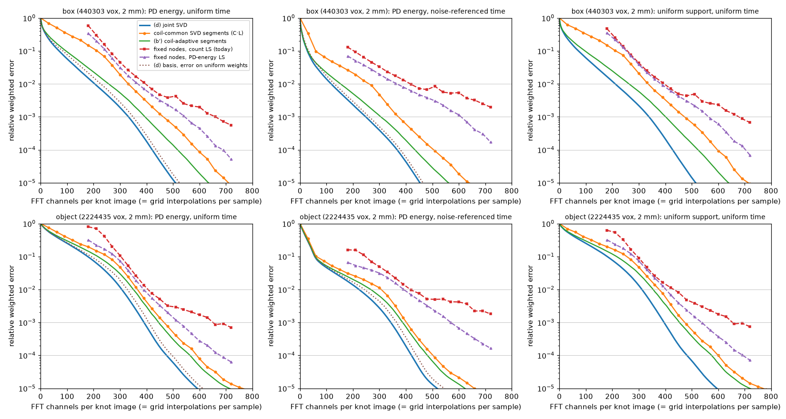

# Joint coil × time-segment compression of the segmented NUFFT's diagonals

Study of 2026-11-18 on ph0001 (`factory_arms`, `sim_flow_10min`, 2 mm, 3 T). CPU only, no library changes. Scripts and
results are in `research/experiments/cl_compress/`. Context: `temporal_operator.md` §16–§22 (operator, measured costs),
`segment_basis.md` (noise-referenced segment rule), `RESEARCH_fast_normal_operator.md`.

## 0. Answer

**Question.** The operator spends one FFT per (coil c, segment l) per knot image, and one grid interpolation per
(c, l) per sample. Can the C·L spatial functions D_cl = S_c P_l be replaced by R ≪ C·L shared functions Φ_q, with a
per-sample mixing y_c = Σ_q B_cq(τ) g_q?

**Short answer.** It works and it is exact apart from the truncation, but the gain is modest. It is largest on the
160 mm heart box and small on the whole object. Every comparison below is at equal operator error, over the full
**ratemap**: one complex rate per voxel covering off-resonance, decay and the folded six-peak fat spectrum, plus the
encode-mean concomitant phase. Weights are signal (proton-density) energy.

| region (2 mm) | weighting | ε | today (fixed nodes, count LS) C·L | best coil-common segments (SVD) C·L | **joint R** | joint gain vs best segments |
|---|---|---|---|---|---|---|
| 160 mm box | PD energy, uniform time | 1e-2 / 1e-3 / 1e-4 | 420 / 690 / >720 | 360 / 480 / 600 | **205 / 333 / 422** | 1.76 / 1.44 / 1.42 |
| 160 mm box | noise rule (R_pred = 0.2/1.5, ε = 2.8e-3) | | 690 | 330 | **189** | 1.75 |
| whole object | PD energy, uniform time | 1e-2 / 1e-3 / 1e-4 | 420 / 660 / >720 | 390 / 480 / 600 | **307 / 391 / 476** | 1.27 / 1.23 / 1.26 |
| whole object | noise rule | | 660 | 390 | **299** | 1.30 |

(Full tables, other weightings and variants: §3.)

- **Variants.**
  - (d) The joint SVD over (coil, time), "coil-aware segmentation", is the optimum of this operator family. It is the
    only variant worth building.
  - (b) A Tucker product (separate coil × segment bases) gains little over the coil-common segments: only at 1e-2
    (box 312 vs 360). Below that all 30 virtual coils are needed. Coil-adaptive segment counts (b') recover about half of (d)'s gain.
  - (c) Spatial blocks are 2.7–20× **worse**: the channels of the blocks add up.
  - (a) Compressing today's C·L diagonals afterwards reaches (d) once L is large enough for the target. Below that it
    is capped by the segmentation error.
- **Mechanism.** Weak virtual coils need fewer segments (that is (b')), and products of coil maps with segment
  functions share spatial content (the rest of (d)). Over a small region both effects are strong. Over the whole
  object the coils become nearly independent and the gain falls to about 1.25×.
- **Cost (§5).** Both the image side and the sample side scale with the channel count. The per-sample mixing (C·R
  MACs, a B table read from L2) and generating Φ_q on the fly cost about 1–2 % at these sizes.
  - **Box, 1 mm, one 4090, 30 M samples per encode pass:** at the noise rule, 94 s instead of 162 s (best segments)
    or 338 s (today's fixed nodes at equal error). At 1e-3, 165 s instead of 235 s.
  - **Torso, 1 mm:** the gain is ≈ 1.25× over the best segments. At the noise rule that is ≈ 1280 s instead of
    1640 s per encode pass. Most of the gain against today's fixed nodes is already available from the existing SVD
    segment basis (`--seg-basis svdn`), with no new machinery.
- **Costs that the channel count does not show.**
  - **Weight sensitivity.** The joint basis concentrates error where the signal weight is small. Point-image error at
    the 99th percentile is ≈ 2.5–3× that of the segment basis at the same global ε (§3.4).
  - **Basis rebuilding** (§6). It costs ≈ 6× the coil-common SVD per voxel. On a GPU that is seconds (box) to a few
    minutes (torso, fp64) per rebuild. One basis serves all 7 encodes (§2.6).
  - **Toeplitz path.** The coil factorisation is lost. A Toeplitz normal operator would need R(R+1)/2 kernels, so
    this is a NUFFT-path optimisation only.
- **Verdict.**
  - Worth a GPU prototype for the **box / pyramid dev path**, where it is ≈ 1.75× at the noise rule and ≈ 1.4× at 1e-4.
  - For the torso, first switch the segments to the SVD basis (1.4–1.7× vs today at equal accuracy, already
    implemented). The joint step adds 1.25× more.
- **Side finding.** Today's target config (L = 10 fixed nodes) has 3–4.5 % operator error on the box, and 5–11 % on the
  whole object, once decay and fat are part of the ratemap (§3.1–3.2). At 1e-2 it needs L ≈ 14 fixed / 12–13 SVD.

## 1. Setup (what was computed)

- **Coils.**
  - The 32 physical maps (`smaps_true.hv`) are whitened with Ψ^{−1/2}, using the Ψ stored in `meta.json` (so no
    identity approximation was needed).
  - They are SV-compressed as `splinerecon` does it: the Gram of the whitened encode-0 data, every readout with
    stride for ≤ 2·10⁵ samples, then the 30 strongest eigenvectors. 99.9 % of the energy needs 30 coils with the
    sim's noise added to the Gram (σ² per whitened coil) and 29 on the clean data. C = 30 is used.
  - The maps are stored with 13-bit mantissas (relative rms ≈ 3.5·10⁻⁵). That puts an error floor of
    ε² ≈ 1.2·10⁻⁹ under every curve: harmless at ε = 1e-4 (10⁻⁸).
- **Ratemap** (`--phys ratemap`). g(r, τ) = exp(−iω(r)τ − i Σ_q w̄_q(τ) m_q(r)) · exp(−r₂(r)(τ − τ₀)) ·
  ((1 − ff) + ff·c(τ)):
  - ω from `field_ppm_recon.npy` (b0 = 3 T from meta);
  - the decay rate from `truth_r2s.npy`;
  - ff from `truth_ff.npy`, c(τ) the six-peak spectrum of `hasty_qfit::waterfat::FatSpectrum` (same ppm and
    amplitudes);
  - w̄ = encode-0 mean concomitant coefficients per ADC sample (`sched_nominal` columns 9–12), monomials
    [z², x² + y², xz, yz] at the nominal positions (**GNL not applied**: maps and rates at the logical voxel
    centres);
  - τ ∈ [1.600, 9.578] ms (3990 ADC samples).
  - `--phys conc` (off-resonance + concomitant only) was run on the box with an earlier weighting: `out/*_reconweights*`.
- **Regions.** Signal support = PD (water + fat) > 0.01:
  - whole object: 2 224 435 voxels at 2 mm;
  - the 160 mm cube placed at the truth-lumen centroid (voxel [133, 66, 52]; box origin [93, 26, 12]): 440 303
    support voxels.
  - The lumen is used only to place the box.
- **Weights.**
  - Voxel: 'e' = (PD_water + PD_fat)², the signal energy; voxels without signal carry no weight. 'u' = 1 on the
    support, which gives the exact ‖ΔA‖_F / ‖A‖_F for images supported there (§2.3).
  - Time: 'u' uniform per ADC sample; 'd' the measured whitened data energy E(n) (≈ the relative data error for
    smooth images); 'm' = 1 + (E(n) + E_vol)/(Cσ²), the noise-referenced weights of `segment_basis.md` §2. For 'm'
    the project rule R_pred = ε·√mean(w_m) ≤ 0.2 with the ×1.5 margin gives ε = 2.8·10⁻³ (mean w_m = 2235).
- **Errors** are all *after* fitting the bases and interpolators, on a 472-point time grid. That grid is
  `seg_time_grid` with the 'm' and 'd' weights (96 each), 160 uniform ADC indices, and the exact node times of every
  fixed segmentation L = 6…24. Each ADC sample is assigned to its nearest grid time for the quadrature.

## 2. Derivation

### 2.1 Operator identity

Per coil c, sample j (k_j, τ_j): y_c(j) = Σ_r e^{−ik_j·r} E_c(r, τ_j) x(r), with E_c = S_c(r) g(r, τ).
Take any separable approximation

  E_c(r, τ) ≈ Ẽ_c(r, τ) = Σ_{q=1}^{R} B_cq(τ) Φ_q(r).

Then, by linearity of the NUFFT F (same kernel, grid and table for every channel),

  forward  ỹ_c(j) = Σ_q B_cq(τ_j) [F(Φ_q x)](k_j),
  adjoint  x̂ = Σ_q conj(Φ_q) · F^H[ Σ_c conj(B_cq(τ_j)) r_c(j) ].

This costs R FFT channels per knot image and R grid interpolations per sample, plus C·R complex MACs per sample for
the mixing. The mixing is applied once after the knot sum, ỹ_c = Σ_q B_cq Σ_k b_k(t) g_{q,k}, so it does not scale
with the s knots per sample.

Today's segmentation is the special case q = (c, l), Φ_(c,l) = S_c P_l, B_{c',(c,l)} = δ_{cc'} a_l(τ): a
block-diagonal B, C·L channels. The NUFFT's own approximation (kernel, σ) is the same per channel, so the
compression error adds to it and does not multiply it.

### 2.2 Optimal basis (Eckart–Young) and the Gram reduction

With voxel weights w_r and time quadrature t_i, the error is

  ε² = Σ_r w_r Σ_{c,i} t_i |E_c(r, τ_i) − Ẽ_c(r, τ_i)|² / Σ_r w_r Σ_{c,i} t_i |E_c|².

Over all rank-R forms this is minimised by the truncated SVD of the matrix [√t_i E_c(r, τ_i) √w_r] (rows (c, i),
columns r): ε²(R) = Σ_{q>R} λ_q / Σ λ_q, where λ are the eigenvalues of the (c, τ) Gram G = Σ_r w_r e_r e_rᴴ.

**Every structured variant is a choice of a subspace U ⊂ ℂ^{C·n_τ}, and its error is tr((I − P_U) G).**
- Coil-common segments: U = I_C ⊗ V_L.
- Tucker: U = U_c ⊗ U_t.
- Coil-adaptive segments: U = ⊕_s u_s ⊗ V^{(s)}.
- Fixed nodes: an interpolation, i.e. an oblique projector.

So all variants follow from one Gram per (region, weighting).

**Exact reduction.** The coil-common time Gram G_τ = Σ_r w_r Σ_c |S_c|² g_r g_rᴴ gives an orthonormal time basis V
(n_τ × K) with g_r = V h_r to a relative residual ≤ 10⁻¹³ under every weighting. That needs K = 40 (box) or 46
(object). Then

  G = (I_C ⊗ V) H (I_C ⊗ V)ᴴ,   H = Σ_r w_r z_r z_rᴴ,   z_r = S(r) ⊗ h_r ∈ ℂ^{CK}

(CK = 1200 / 1380), and a time weighting T enters only through Mw = Vᴴ T V (K × K): Ht = (I ⊗ Mw^½) H (I ⊗ Mw^½).
Changing the time weighting therefore needs no new pass over the voxels.

### 2.3 What the error numbers mean

1. **Frobenius identity (exact).** |e^{−ik·r}| = 1, so ‖ΔA‖²_F = Σ_{c,j} Σ_r |Δ_c(r, τ_j)|² and
   ‖A‖²_F = Σ_{c,j} Σ_r |E_c(r, τ_j)|². The 'uu' error is exactly ‖ΔA‖_F / ‖A‖_F for operators on the support.
2. **Images with energy profile w and incoherent phase.** E‖ΔA x‖² = Σ_r w_r Σ_{c,j} |Δ_c|² when E|x_r|² = w_r and
   the phases are independent. That is the 'eu' number. For smooth (coherent) images the k-space centre sees coherent
   sums. The proportional model (time weights = data energy, 'ed') then predicts ‖Δy‖/‖y‖; §3.5 checks this at real
   samples.
3. **Point images (exact).** For x = δ_r, ‖ΔA δ_r‖/‖A δ_r‖ = ρ(r) = (Σ_{c,j} |Δ_c(r, τ_j)|² / Σ_{c,j} |E_c|²)^{1/2}.
   So max_r ρ(r) is a lower bound on the worst-case relative error over all images. An upper bound is
   ‖ΔA x‖² ≤ Σ_τ ‖F_τ‖² max_r Σ_c |Δ_c(r, τ)|² ‖x‖² (F_τ = the DFT at the samples of ADC time τ).
4. **Noise units.** R_pred = ε_m √(mean w_m) (`segment_basis.md` §2). R = 0.2 adds 4 % to the residual energy.

### 2.4 Off-grid times

The interpolators are B_c(τ) = least squares over voxels: B_cq(τ) = ⟨E_c(·, τ), Φ_q⟩_w / λ_q, since
Φ_q are w-orthogonal with norms λ_q. B is linear in V(τ), so it is as smooth in τ as g. Tabulate it at the 3990 ADC
times, or on 128 entries with interpolation as today (check the table error).

### 2.5 Per-sample concomitant corrections (variant e): compatible, exactly

The residual phase of sample j relative to the encode mean, δψ_j(r) = φ0_j + δb_j·r + ½ rᵀδC_j r (+ degree 3/4 to
first order), is applied per sample as a linear functional ℓ_j on a channel's grid: shifted and derivative kernel
weights. ℓ_j does not depend on the channel, so y_c(j) = Σ_q B_cq(τ_j) ℓ_j[G_q] holds with the same Φ and B. The
correction work per sample scales with the channel count, so it shrinks by C·L/R too. GNL (maps and rates at the
warped positions) lives inside S_c and g and is compatible as well.

### 2.6 One basis for all 7 encodes

The encode-mean concomitant coefficients of the 7 encodes differ only by a constant (the encoding lobes, before the
ADC). Their dynamics over the readout are identical: max |w̄_e(τ) − w̄_e(τ₀) − (w̄_0(τ) − w̄_0(τ₀))| = 0.000 rad/m²
for every term. A voxel phase e^{−iθ_e(r)} common to all (c, τ) leaves the Gram unchanged. So

  Φ_q^{(e)} = e^{−iθ_e(r)} Φ_q,  same B,  θ_e = Σ_q (w̄_{e,q}(τ₀) − w̄_{0,q}(τ₀)) m_q(r),

and one basis serves all encodes. The phase can be folded into the pad multiply or into the knot image.

### 2.7 Fat and dynamic fields

- Folded fat (one ff map, the single-image ratemap above) costs no extra channels.
- With water and fat as separate images, E^f = c(τ) E row-wise. Then the same Φ with B^f = c(τ) B represents fat with
  error ≤ the water error (|c| ≤ 1). Fat still needs its own R channels F(Φ_q x_f), as today's 2·C·L.
- A ratemap that changes per respiratory knot (dynamic B0, `temporal_operator.md` §12) needs either a union basis
  over states (larger R) or one basis per state. Not measured.

### 2.8 Toeplitz normal operator: not compatible

The coil-free Toeplitz form (`normal_op_coil_factorization`: coils outermost, L(L+1)/2 coil-free kernels) relies on
S_c factoring out. With joint channels the kernels become T_{qq'} with weights Σ_c conj(B_cq) B_cq'(τ_j), so
R(R+1)/2 kernels. **Use the joint compression only on the NUFFT (gridding) path.**

## 3. Results

Generated by `cl_rank.py` (one run per region) and `tables.py`; figure `experiments/cl_compress/figs/err_vs_channels.png`.
Channel counts are FFT channels per knot image, which equals grid interpolations per sample. "today" = fixed uniform
nodes, least-squares interpolators with equal weights over the coil-energy fit set (every 13th voxel with Σ|S|² >
10⁻³ max: `build_segments`). "fixed_e" = the same nodes with PD-energy-weighted least squares. "seg_svd" = the
optimal coil-common segments for the same weighting (`--seg-basis svdn`-like). "—" = not reached with L ≤ 24.

### 3.1 160 mm box (440 303 voxels, K = 40)

PD-energy voxel weights. Time weights: **uniform ('eu')**

| ε | today C·L | fixed_e C·L | seg_svd C·L | Tucker Rc×Rt | (b') coil-adaptive | (c) 8 / 64 blocks | (a) L = 20 | **(d) joint R** | today / d | seg_svd / d |
|---|---|---|---|---|---|---|---|---|---|---|
| 1e-2 | 420 | 390 | 360 | 312 (26×12) | 257 | 557 / 1653 | 206 | **205** | 2.05 | 1.76 |
| 3e-3 | 540 | 480 | 420 | 406 (29×14) | 336 | 858 / 2679 | 293 | **277** | 1.95 | 1.52 |
| 1e-3 | 690 | 570 | 480 | 480 (30×16) | 395 | 1174 / 3820 | — | **333** | 2.07 | 1.44 |
| 3e-4 | — | 630 | 540 | 540 (30×18) | 459 | 1554 / 5291 | — | **382** | — | 1.41 |
| 1e-4 | — | 690 | 600 | 600 (30×20) | 518 | 1916 / 6826 | — | **422** | — | 1.42 |

**Noise-referenced ('em')**

| ε | today C·L | fixed_e C·L | seg_svd C·L | Tucker Rc×Rt | (b') coil-adaptive | (c) 8 / 64 blocks | (a) L = 20 | **(d) joint R** | today / d | seg_svd / d |
|---|---|---|---|---|---|---|---|---|---|---|
| 1e-2 | 420 | 390 | 270 | 260 (26×10) | 154 | 322 / 1019 | 127 | **118** | 3.56 | 2.29 |
| **2.8e-3 (noise rule)** | 690 | 540 | 330 | 330 (30×11) | 240 | 565 / 1833 | — | **189** | 3.65 | 1.75 |
| 1e-3 | — | 630 | 390 | 390 (30×13) | 306 | 810 / 2688 | — | **249** | — | 1.57 |
| 1e-4 | — | — | 510 | 510 (30×17) | 435 | 1465 / 5211 | — | **367** | — | 1.39 |

**Data energy ('ed', ≈ ‖Δy‖/‖y‖)**

| ε | today C·L | fixed_e C·L | seg_svd C·L | Tucker Rc×Rt | (b') coil-adaptive | (c) 8 / 64 blocks | (a) L = 20 | **(d) joint R** | today / d | seg_svd / d |
|---|---|---|---|---|---|---|---|---|---|---|
| 1e-2 | 420 | 390 | 180 | 180 (30×6) | 102 | 244 / 827 | 91 | **84** | 5.00 | 2.14 |
| 1e-3 | — | 630 | 360 | 360 (30×12) | 251 | 656 / 2241 | — | **200** | — | 1.80 |
| 1e-4 | — | — | 480 | 480 (30×16) | 391 | 1249 / 4494 | — | **327** | — | 1.47 |

Uniform voxel weights on the support ('uu', the exact ‖ΔA‖_F/‖A‖_F) give nearly the same counts: d = 211 / 339 / 429
vs seg_svd 360 / 480 / 600 at 1e-2 / 1e-3 / 1e-4. Full tables: `experiments/cl_compress/out/tables_box.md`.

Fixed-node error at L = 10 (today's target count) with the full ratemap: 4.5·10⁻² (eu), 3.3·10⁻² (em/ed).
(a) is checked against the fixed baseline: its error at R = C·L reproduces the fixed error to all printed digits for
L = 10, 12, 16, 20. (a) reaches only what its L allows, but where it does, R(a) ≈ R(d) (206 vs 205).

### 3.2 Whole object (2 224 435 voxels, K = 46)

**'eu'**

| ε | today C·L | fixed_e C·L | seg_svd C·L | Tucker Rc×Rt | (b') coil-adaptive | (c) 8 / 64 blocks | (a) L = 20 | **(d) joint R** | today / d | seg_svd / d |
|---|---|---|---|---|---|---|---|---|---|---|
| 1e-2 | 420 | 390 | 390 | 390 (30×13) | 351 | 887 / 2871 | 308 | **307** | 1.37 | 1.27 |
| 3e-3 | 510 | 480 | 420 | 420 (30×14) | 401 | 1255 / 4345 | 360 | **353** | 1.44 | 1.19 |
| 1e-3 | 660 | 540 | 480 | 480 (30×16) | 446 | 1631 / 5888 | — | **391** | 1.69 | 1.23 |
| 3e-4 | — | 600 | 540 | 540 (30×18) | 502 | 2060 / 7759 | — | **432** | — | 1.25 |
| 1e-4 | — | 690 | 600 | 600 (30×20) | 565 | 2442 / 9618 | — | **476** | — | 1.26 |

**'em'**

| ε | today C·L | fixed_e C·L | seg_svd C·L | Tucker Rc×Rt | (b') coil-adaptive | (c) 8 / 64 blocks | (a) L = 20 | **(d) joint R** | today / d | seg_svd / d |
|---|---|---|---|---|---|---|---|---|---|---|
| 1e-2 | 420 | 420 | 330 | 330 (30×11) | 268 | 536 / 1682 | 230 | **223** | 1.88 | 1.48 |
| **2.8e-3 (noise rule)** | 660 | 510 | 390 | 390 (30×13) | 346 | 872 / 2903 | — | **299** | 2.21 | 1.30 |
| 1e-3 | — | 570 | 420 | 420 (30×14) | 388 | 1180 / 4135 | — | **344** | — | 1.22 |
| 1e-4 | — | — | 510 | 510 (30×17) | 482 | 1936 / 7442 | — | **421** | — | 1.21 |

**'ed'**

| ε | today C·L | fixed_e C·L | seg_svd C·L | Tucker Rc×Rt | (b') coil-adaptive | (c) 8 / 64 blocks | (a) L = 20 | **(d) joint R** | today / d | seg_svd / d |
|---|---|---|---|---|---|---|---|---|---|---|
| 1e-2 | 420 | 420 | 210 | 210 (30×7) | 174 | 393 / 1298 | 157 | **150** | 2.80 | 1.40 |
| 1e-3 | — | 570 | 390 | 390 (30×13) | 356 | 971 / 3381 | — | **307** | — | 1.27 |
| 1e-4 | — | — | 480 | 480 (30×16) | 447 | 1676 / 6414 | — | **398** | — | 1.21 |

'uu': d = 312 / 396 / 483 vs seg_svd 390 / 480 / 630. Fixed-node error at L = 10: 1.1·10⁻¹ (eu), 4.9·10⁻² (em).
Coil-adaptive segment counts are flat here: 13–17 per coil at ε = 1e-3 (eu), against 9–18 on the box. That is
mechanism 1 of §4 weakening. Full tables: `out/tables_object.md`.

### 3.3 Hold-out (voxel parity) and weight mismatch

**Voxel parity.** The basis is built from the even voxels and its error measured on the odd ones, at the R of
the full-data count (PD weights).

| | ε = 1e-2 | 3e-3 | 1e-3 | 3e-4 | 1e-4 |
|---|---|---|---|---|---|
| box eu | 9.9e-3 | 3.0e-3 | 1.08e-3 | 3.9e-4 | 1.6e-4 |
| box em | 9.9e-3 | 3.0e-3 | 1.0e-3 | 3.1e-4 | 1.15e-4 |
| object eu | 1.01e-2 | 3.1e-3 | 1.11e-3 | 3.7e-4 | 1.5e-4 |
| object em | 1.00e-2 | 3.0e-3 | 1.01e-3 | 3.3e-4 | 1.17e-4 |

- Down to 1e-3 the basis generalises.
- At 1e-4 the held-out half sees 1.2–1.6× the target. The last ≈ 100 basis functions fit voxel-specific structure
  (interfaces, fat edges). That is harmless when the basis is built on the operator's own voxels, as it would be.
- What this does mean: an image whose energy sits where the build weights were small gets a larger error.

**Weight mismatch.** The basis built on PD energy and evaluated on uniform support weights needs +10–25 channels for
the same ε ("e-basis on uniform w" in `out/tables_*.md`):
- box eu: 228 / 350 / 437 vs 205 / 333 / 422;
- object eu: 328 / 409 / 497 vs 307 / 391 / 476.

### 3.4 Point-image (per-voxel) error

ρ(r) is the exact relative error for a single-voxel image at r (§2.3). Percentiles over the support voxels,
uniform time weights, at the channel counts of the 'eu' row; "seg" = the coil-common SVD segments at their own count
for the same ε.

| region, ε | joint p50 / p99 / p99.9 / max | seg p50 / p99 / p99.9 / max | PD-energy fraction with ρ > 10ε: joint / seg |
|---|---|---|---|
| box 1e-3 | 2.7e-3 / 1.9e-2 / 4.2e-2 / 0.23 | 1.1e-3 / 6.3e-3 / 1.4e-2 / 0.49 | 1.6e-2 / 1.2e-3 |
| box 1e-4 | 2.3e-4 / 2.3e-3 / 5.8e-3 / 3.9e-2 | 1.5e-4 / 8.4e-4 / 1.8e-3 / 5.5e-2 | 1.6e-2 / 1.5e-3 |
| object 1e-3 | 7.9e-4 / 2.6e-2 / 5.7e-2 / 0.65 | 4.0e-4 / 8.9e-3 / 1.5e-2 / 0.82 | 1.7e-2 / 9.0e-4 |
| object 1e-4 | 1.3e-4 / 3.1e-3 / 7.3e-3 / 0.16 | 6.2e-5 / 1.3e-3 / 2.4e-3 / 0.36 | 1.1e-2 / 2.3e-3 |

- At the same global ε the joint basis has ≈ 2.5–3× larger point errors at the 99th percentile. About 1.5 % of the
  signal energy sees > 10ε, against ≈ 0.1–0.2 % for the segments.
- The joint fit spends its rank where the energy is.
- The *maximum* is smaller for the joint basis: the worst voxels of both are low-signal interface voxels, and there
  the segment basis does worse.
- So for a guaranteed point-wise accuracy the joint R must be chosen on a sup-type criterion, or the build weights
  floored (e.g. w ≥ 0.1·median). That costs part of the gain; measure it in the prototype (§8).

### 3.5 Data-space check at real samples

`kcheck.py --tk d`, box, PD-energy weights, data-energy time weights:
- joint R = 84 / 200 / 327 and seg L = 6 / 12 / 16 (the 'ed' counts for 1e-2 / 1e-3 / 1e-4);
- Φ from the Gram, B(τ) and a(τ) refitted by least squares at the *actual ADC times*;
- x = PD_water + PD_fat (real, positive: the most coherent image at k = 0);
- direct DFT at the real k of 48 readouts spread over the scan, all 30 virtual coils, 40 ADC indices from the
  k-space centre to the readout turn;
- totals weighted by the data energy over all 3990 indices (log-interpolated).

| | joint 1e-2 | joint 1e-3 | joint 1e-4 | seg 1e-2 | seg 1e-3 | seg 1e-4 |
|---|---|---|---|---|---|---|
| ‖Δy‖/‖y‖ at the real samples | 1.28e-2 | 1.73e-3 | 1.83e-4 | 1.35e-2 | 1.06e-3 | 1.24e-4 |
| separable prediction (same weights) | 1.00e-2 | 1.02e-3 | 1.02e-4 | 1.03e-2 | 5.7e-4 | 6.6e-5 |
| ratio | 1.28 | 1.70 | 1.79 | 1.31 | 1.86 | 1.88 |

- The separable proxy is optimistic by 1.3–1.9×, **the same factor for the joint basis and the segments**. That is
  the ×1.5–2 of `segment_basis.md` §2/§5, and the noise rule's ×1.5 margin covers it.
- Per ADC index:
  - At the k-space centre (|k| < 70 rad/m, where 67 % of the data energy is) the joint error is 2–4× *below* its
    proxy: smooth coherent errors largely cancel.
  - In the outer readout (|k| > 600 rad/m) both bases are 2× *above* their proxies. That is the white floor of
    rough errors.
- Equal-weight comparison: the joint basis meets the data-space accuracy of the segments at 200 vs 360 channels
  (ε = 1e-3 predicted). Its actual 1.7e-3 vs 1.1e-3 comes from the seg count's coarse L steps overshooting the
  target (5.7e-4 predicted).

## 4. Why the joint basis wins, and why less on the whole object

The Gram is G = Σ_r w_r (S_r S_rᴴ) ⊗ (g_r g_rᴴ). Two effects lower its effective rank below C·L.

1. **Weak virtual coils need fewer segments.**
   - The error is absolute (white noise per whitened virtual coil), so a coil carrying 10⁻³ of the energy only needs
     its segments to √10⁻³ relative accuracy. Coil-common segments give every coil the L of the strongest.
   - (b') makes this explicit. Its optimal per-coil counts at ε = 1e-3 on the box (uniform time) run from 16–18
     segments for the strongest region coils down to 9–10 for the weakest. With data-energy time weights they run
     12 → 2.
   - This alone recovers about half of (d)'s gain: box ε = 1e-3, 480 → 395 (b') → 333 (d).
2. **Products share spatial content.** The rest of the gain:
   - Coil maps are smooth, and over a 160 mm box their spans overlap the low-order content of the segment functions.
   - Products S_c · P_l of two smooth families span far fewer independent functions than C·L. Polynomials of degree
     a times degree b give degree a + b, not the product count.
   - Over the whole object (508 × 288 × 228 mm, arms included) each coil sees a different part of the body, and the
     ratemap's structure (interfaces, fat) lies in different coils' fields of view. The products become nearly
     independent and the gain drops from ≈ 1.4–1.8× (box) to ≈ 1.25× (object).

**Spatial blocking (c) fails for the opposite reason.** Per block the rank falls only modestly, e.g. 8 blocks of the
box need on average 70 channels each at ε = 1e-2 against 205 for the whole box. The channels of different blocks
cannot be shared, so they add up (557). The k-space side is global, so every block channel costs a full interpolation
per sample.

**Fixed nodes vs SVD, in passing.** Today's fixed-node basis with equal-weight least squares over the coil-energy
fit set (air included) is 1.15–2× more channels than the SVD segments at equal error. The ratio is largest under
data-energy and noise weights: the fixed curves flatten near 10⁻² … 10⁻³ in the em/ed panels of the figure. This
matches `segment_basis.md` §3 (svdm_e vs fixed) with the ratemap now including decay and fat.

## 5. Cost model per encode pass (forward + adjoint)

**Model.** Both sides of the operator scale with the channel count:
- image side: FFTs per knot image;
- sample side: passes of a fixed channel batch, 100 at the box with cb 10 and 10 at the torso with cb 1
  (`temporal_operator.md` §22.3).

Unit costs are §22.6 (one RTX 4090, 30 M samples per encode, 96 knots, s = 8, order 3), which were given there for
300 channels:
- **box 1 mm: 0.49 s per channel** (25 + 122 s per 300);
- **torso 1 mm: 4.21 s per channel** (651 + 612 s per 300).

The joint form adds, per pass and direction:
- the mixing: C × batch MACs per sample, plus the B rows read from L2, ≈ 24 KB per sample per pass at the box,
  assumed 4 TB/s;
- generating Φ_q for the batch once from S_c and h_k: CK MACs per voxel per channel, assumed 40 TFLOP/s effective.

These come to 1.1–2.8 s per encode pass at the box and 17–27 s at the torso, ≈ 1–1.3 % [estimates; §8 step 1
measures them].

| case | ε | today (fixed, count LS) | fixed_e | best segments (SVD) | (b') | **(d) joint** |
|---|---|---|---|---|---|---|
| box 1 mm, one 4090 | noise rule 2.8e-3 | 690 ch · 338 s | 540 · 265 s | 330 · 162 s | 240 · 118 s | **189 · 94 s** |
| | eu 1e-3 | 690 · 338 s | 570 · 279 s | 480 · 235 s | 395 · 194 s | **333 · 165 s** |
| | eu 1e-4 | > 720 | 690 · 338 s | 600 · 294 s | 518 · 254 s | **422 · 210 s** |
| | ed 1e-3 | > 720 | 630 · 309 s | 360 · 176 s | 251 · 123 s | **200 · 99 s** |
| torso 1 mm (object counts) | noise rule | 660 · 2779 s | 510 · 2147 s | 390 · 1642 s | 346 · 1457 s | **299 · 1276 s** |
| | eu 1e-3 | 660 · 2779 s | 540 · 2273 s | 480 · 2021 s | 446 · 1878 s | **391 · 1668 s** |
| | eu 1e-4 | > 720 | 690 · 2905 s | 600 · 2526 s | 565 · 2379 s | **476 · 2031 s** |

- §22.6's per-gradient rule on 8 × 5090 is ×0.625.
- **Torso at the noise rule:** 1026 s (best segments) → 798 s (joint) per gradient, i.e. 28 h → 22 h for 100
  iterations. Still far over the 5–6 h budget: the joint compression is not what closes the torso gap.
- **Box (7 encodes):** 101 s → 59 s per gradient on 8 × 5090. On one 4090 it is 19 min → 11 min per gradient
  (7 × 162 s → 7 × 94 s).

**Where it wins.** It wins wherever channels dominate, which here is everywhere: the per-channel model holds on both
sides. The *ratio* is set by the region: 1.4–2.3× over the best segments on a 160 mm box, 1.2–1.5× on the whole
object. Against today's fixed nodes at equal error it is 2–3.7× (box) and 1.4–2.2× (object), but most of that is
already in the SVD segments.

**Memory.** Φ is never stored. Per channel batch it is generated from the coil maps and h_k(r) = Vᴴg_r, which comes
from the ratemap per voxel (n_τ sincos + n_τK MACs). The batch buffer is batch × nv × 8 B: 3.3 GB at the box
(batch 100) and 7.6 GB at the torso (batch 10). The torso's 14.7 GB slot + 7.6 GB fits a 5090 (32 GB) but not a
4090 at batch 10. The B table is 3990 × C × R × 8 B = 18–45 MB.

## 6. Finding the bases, and rebuilding them during the recon

**What a build is.**
1. Time Gram G_τ (n_τ² per voxel) → V (K ≈ 40–46).
2. Reduced Gram H = Σ_r w_r z_r z_rᴴ: (CK)² per voxel, CK = 1200–1380.
3. eigh(H) (CK³).
4. B(τ) at the ADC times: B_cq(τ) = Σ_k V_k(τ) [(I ⊗ Mh^{−1}) Q]_{(c,k),q}, which needs V at the ADC times (the
   least-squares extension of §2.4: N·K per ADC time).

Φ_q is never stored: it is generated per channel batch from S_c and h_k(r) = V^H g_r (§5).

**Measured** (CPU, fp64, 8 threads ≈ 210 GFLOP/s zgemm; `timing` in the json files). These runs computed three
Grams per voxel (even, odd and uniform weights) plus 64 block Grams. A production build needs one.

| | voxels | time Gram (3 Grams) | reduced Gram (3 GEMM-equivalents) | eigh(H) | production build (1 Gram) |
|---|---|---|---|---|---|
| box 2 mm | 440 303 | 19 s | 65 s | 0.5 s | ≈ 30 s |
| object 2 mm (CK 1380) | 2 224 435 | 95 s | 440 s | 0.65 s | ≈ 3 min |

**Flop model:** 8·(CK)²·N for H, the dominant term. The coil-common SVD segments need 8·n_τ²·N, ≈ 6× less; fixed
nodes need only an L × L solve per table entry.

| case | N (signal voxels) | H flops | CPU fp64 (8 thr) | GPU fp64 (4090/5090 ≈ 1.3–1.6 TFLOP/s) | GPU fp32 TSQR / randomised (≈ 4× flops, ≈ 40 TFLOP/s eff.) |
|---|---|---|---|---|---|
| box 1 mm | ≈ 3.5 M | 4.0·10¹³ | ≈ 3 min | ≈ 30 s | ≈ 4 s |
| torso 1 mm (CK 1380) | ≈ 17.8 M | 2.7·10¹⁴ | ≈ 22 min | ≈ 3–3.5 min | ≈ 30 s |

**Precision.**
- An fp32 *Gram* is not enough below ε ≈ 10⁻³. Its error is ~10⁻⁷–10⁻⁶ of ‖H‖, while ε = 1e-4 needs the discarded
  energy right to 10⁻⁸.
- Either accumulate in fp64, or factor Z itself in fp32 (TSQR or a randomised range finder). Singular values then
  carry the square root of the dynamic range: ε = 1e-4 needs σ to 10⁻⁴ relative, far above fp32 round-off.
- The fp64 run here is the reference for that check (§8).

**How often.**
- One basis for all 7 encodes (§2.6).
- A rebuild is needed when the ratemap or the coil maps change (outer B0/decay or joint-smap updates) and when the
  time weights change. Time weights alone need no voxel pass: Mw only, then eigh(CK).
- Cost per rebuild against an encode pass:
  - box: 4–30 s against 93–165 s for the pass;
  - torso: 0.5–3.5 min against ≈ 21 min for the pass.
  Amortised over the CG iterations between outer updates, this is ≲ 2 % with the fp32-TSQR build.
- **Incremental.** H is a sum over voxels, so a local ratemap update changes H by Σ_{changed r}(new − old) outer
  products. The old basis's error on the new H, tr((I − P)H_new), is a cheap acceptance test. A warm-started
  subspace iteration from the old Q costs ≈ 2R/CK of a full Gram per step.
- The coil-common SVD segments stay ≈ 6× cheaper to rebuild. They are the fallback when the ratemap is updated every
  few iterations.

**Hold-out caveat.** A basis built from a *subsample* of the voxels does not generalise at tight ε. Building from
1/16 of the box voxels and testing on another 1/16 (debug run, stride 8) gave 1.5–5× the training error at ε = 1e-4.
The rough content of the ratemap (field interfaces, fat edges) is voxel-specific, so build from all voxels: §3.3 has
the full-resolution parity hold-out.

## 7. Literature (verified 2026-11-18)

Checked against the publisher or author pages. Nothing found does the joint (coil × time) SVD that §2.2 evaluates.

- **Time segmentation with least-squares or min-max interpolators:** Sutton, Noll, Fessler, "Fast, iterative image
  reconstruction for MRI in the presence of field inhomogeneities", IEEE TMI 22(2):178–188, 2003
  (doi:10.1109/TMI.2002.808360). Coil-independent segments: our "fixed".
- **Toeplitz normal operator with the time-segmented model:** Fessler, Lee, Olafsson, Shi, Noll, IEEE TSP
  53(9):3393–3402, 2005 (doi:10.1109/TSP.2005.853152). Relevant to §2.8.
- **Multi-frequency interpolation (MFI):** Man, Pauly, Macovski, MRM 37(5):785–792, 1997 (doi:10.1002/mrm.1910370523).
  The transposed separable form (fixed temporal exponentials, fitted spatial coefficients). A later spiral-MRF paper
  notes that MFI does not handle fat's chemical shift; the folded ratemap here does.
- **SVD of the higher-order phase matrix:**
  - Wilm, Barmet, Pruessmann, "Fast higher-order MR image reconstruction using singular-vector separation", IEEE TMI
    31(7):1396–1403, 2012 (doi:10.1109/TMI.2012.2190991). The perturbing phase is written as a sum of separable
    space × time functions found by singular-vector analysis.
  - Lee, Ramasawmy, Lim, Campbell-Washburn, Nayak, "MaxGIRF", MRM 2022 (doi:10.1002/mrm.29232). An SVD per
    interleaf of the higher-order encoding matrix with coils applied outside (S_c multiplies the low-rank phase
    terms), L ≈ 15–50 in 2-D.
  - Both are coil-independent low-rank decompositions: our "seg_svd". MaxGIRF's coil handling was checked in its
    text (eq. 16).
- **Coils absorbing phase:** Abraham, Nishimura, Cao, Liao, Setsompop, "Implicit Representation of GRAPPA Kernels for
  Fast MRI Reconstruction" (iGROG), arXiv:2310.10823. Learned GRAPPA kernels remove part of the
  coil-sensitivity-weighted field phase before the iterative recon. The abstract reports 3–4× fewer time segments
  for smooth field imperfections (simulation). Time segments come from clustering, and there is no joint coil × time
  SVD. This is the closest analogue of "coils absorb segment rank", but approximate and learned.
- **Coil compression:**
  - Zhang, Pauly, Vasanawala, Lustig, "Coil compression for accelerated imaging with Cartesian sampling" (GCC), MRM
    69(2):571–582, 2013. It needs a fully sampled readout axis. Non-Cartesian extensions (e.g. "A Feasibility Study
    of Geometric-Decomposition Coil Compression in MRI Radial Acquisitions", PMC5474278) set the whole Cartesian grid
    as unknowns.
  - Kim, Cauley, Nayak, Leahy, Haldar, "Region-optimized virtual (ROVir) coils", MRM 86:197–212, 2021
    (doi:10.1002/mrm.28706). A generalised-eigenvalue coil mixing that keeps a region's signal and suppresses the
    outside.
  - Neither touches the segment dimension.
  - ROVir is relevant to the box recon independently of this note: it could replace or help the out-of-box
    subtraction of `temporal_operator.md` §22.7. Not evaluated.
- **Not verified / not found:** a published joint SVD of {S_c(r) e^{−iω(r)τ}} over (c, τ) for NUFFT channel
  reduction. The search covered coil compression + off-resonance, joint low-rank sensitivity × field, GCC
  non-Cartesian, MFI and singular-vector separation.

## 8. GPU prototype: what to measure first

Pre-registered order. Each step decides whether the next one is worth doing.

1. **Measured cost per channel at R ≈ 190–330 on the box engine** (1 mm, s = 8, order 3, 30 M samples).
   - Question: is the sample side linear in channels at batch 100, or is there a per-pass overhead the joint form
     changes?
   - Also measure the mixing kernel (C × batch MACs plus the B-table read per sample per pass) alone.
   - Decision: if mixing + Φ generation > 5 % of the pass, restructure: sort tile entries by ADC index, use fp16 B.
2. **Operator accuracy end to end on the GPU.**
   - The forward/adjoint of the joint operator against today's operator at L = 24 fixed_e (ε ≈ 5·10⁻⁵ box) and
     against a direct-sum reference on a small grid.
   - Check ‖Δy‖/‖y‖ at the real samples against the predictions of §3.5. Pass: within 1.5× of the 'ed' prediction at
     every ADC index.
   - Include the order-3 per-sample corrections (§2.5) in this test.
3. **Basis build on the GPU in fp32** (TSQR or randomised range finder on Z, not the fp32 Gram) against the fp64 CPU
   basis.
   - Pass: captured-energy loss < 0.1 ε².
   - Time it at box and torso size (§6 estimates).
4. **Rebuild tolerance.** Perturb the ratemap as an outer B0/decay update would (e.g. ±20 Hz smooth, ±10 s⁻¹) and
   measure the error of the *old* basis. This decides how often to rebuild in the joint ratemap estimation.
5. **Weight robustness.**
   - The real recon's weights come from a warm start, not PD. Build on the warm-start magnitude, evaluate on PD and on
     uniform weights.
   - Report point-image ρ percentiles, because the joint basis concentrates error in low-weight voxels (§3.4).
6. Only then: the torso. Expect ≈ 1.25× over the SVD segments (§5). Do the SVD-segment switch (`svdn`) first, since
   it is already implemented.

## 9. Files

- `experiments/cl_compress/prep.py`: whitener, coil compression (data Gram), per-ADC data energy, encode-0 mean
  concomitant coefficients → `prep.npz`.
- `experiments/cl_compress/cl_rank.py --region box|object --phys ratemap|conc`: Grams, all variants, hold-out,
  per-voxel ρ → `out/<region>_<phys>.json` (+ `out/log_*.txt`).
- `experiments/cl_compress/kcheck.py --tk u|d`: real-sample DFT check (box) → `out/kcheck_<tk>.json`.
- `experiments/cl_compress/tables.py`, `fig.py`.
- Heavy runs were wrapped as `flock <scratch>/cpu.lock systemd-run --user --scope -p MemoryMax=16G -p MemorySwapMax=0
  env OMP_NUM_THREADS=8 …`. Box ≈ 6 min, object ≈ 34 min (of which ≈ 25 min is the per-voxel ρ pass), 8 threads. `kcheck` ≈ 6 min.

## 7. Lead check (2026-11-18): why L > 10 here when Fessler et al. (2005) reach 1e-4 with L = 8

Script: `segcount_check.py` plus inline checks. The SVD is cheap. Only the T × T Gram of the signal-weighted space–time matrix is needed (T ≈ 200 readout times): one pass over the voxels, then an eigendecomposition. The interpolators are the right singular vectors.

**Control: a uniform field with uniform weights.** L for 1e-2 / 1e-3 / 1e-4 relative Frobenius error:

| field span | readout | span × readout | L |
|---|---|---|---|
| 100 Hz | 18.86 ms | 1.9 cycles | 5 / 6 / 7 |
| 440 Hz | 7.98 ms | 3.5 cycles | 7 / 8 / 9 |

The first row reproduces Fessler's L ≈ 8.

**ph0001 heart box (160 mm), signal-weighted.**
- The field's 1–99 % range is only −206 … +234 Hz.
- But the signal-carrying voxels span **−752 … +700 Hz**. The energy fraction with |f| > 300 Hz is 4.3e-3, and with |f| > 600 Hz it is 4e-5.
- At 1e-4 Frobenius error (1e-8 in energy) these tails set L, not the bulk of the distribution.

L for 1e-2 / 1e-3 / 1e-4, with the field clipped to simulate a shim:

| field | water, no decay | with decay |
|---|---|---|
| as simulated | 11 / 14 / 16 | 11 / 14 / 16 |
| clipped ±400 Hz | 9 / 11 / 12 | 9 / 11 / 13 |
| clipped ±300 Hz | 8 / 9 / 11 | 8 / 10 / 11 |
| clipped ±250 Hz | 7 / 8 / 10 | 7 / 9 / 11 |
| clipped ±150 Hz | 6 / 7 / 8 | 6 / 7 / 9 |
| clipped ±100 Hz | 5 / 6 / 7 | 5 / 6 / 8 |

The high L comes from the phantom field's extreme tails in signal-carrying voxels (±750 Hz ≈ ±5.9 ppm at 3 T). It is very likely unrealistic for a shimmed heart. It is not a sign that the method needs that many segments. Other effects in the same data:
- decay adds 0–1 segments; it does not reduce L here;
- folding fat into the same basis adds about 2–3 segments (19 vs 17 at 1e-4, unclipped);
- water and fat as separate species need 17 and 16.

**To do:** make the phantom field realistic (shimmed, with smoother susceptibility transitions), then re-measure. The required L follows the field extent in voxels that carry signal.

## 10. Implementation and measured gains (2026-11-18, GPU)

### 10.1 What was built

- **`hasty_nufft::segjoint`** (new: `segjoint.rs`, `segjoint.cu`).
  - `build_joint_basis` (GPU): time Gram on the GPU (fp64 ZHERK, chunked over the fit voxels; weights w_r Σ_c|S_c|²)
    → ZHEEVD → time basis V (K: relative energy tail ≤ 1e-13); h_r = Vᴴg̃_r for every voxel (ZGEMM, kept on the
    device as fp32, K × nv); reduced Gram H = Σ_r w_r z_rz_rᴴ, z_r = S(r) ⊗ h_r (fp64 ZHERK over the fit voxels), or
    the fp32 TSQR of Zᴴ (CGEQRF of the stacked [R; Z_chunkᴴ], R kept; `fp32_tsqr`) → ZHEEVD → U, λ. B(τ) at the
    table times (the set's ADC times) through the time functions v_k(τ), fitted by voxel-weighted least squares on a
    ≤ 32 768-voxel subset in scaled coordinates (h/√Λ). The ratemap enters as a host closure g(v, t) (any physics).
  - `JointBasis::{tail_error, count_for, error, b_table, uc_table}`: predicted error from the spectrum, count for a
    tolerance, achieved error at the ADC times on the host (time-basis truncation and LS extension included) with
    the point-image ρ(r), the fp32 tables.
  - `JointSegNufft`: an inner `SegNufft` with nseg = 1 and nc = the channel batch (any engine: static, knot-major,
    2-D knots; orders 0–3, the per-sample φ0/ΔC/order-3 terms act on every channel unchanged). Per batch: Φ_q
    generated in place into the inner engine's maps (`joint_phi`: C·K complex MACs per voxel and channel), the inner
    forward / adjoint, the per-sample mixing (`joint_mix_fwd/adj`: blocks of 4 ADC samples × 64 readouts with the
    batch's B rows in shared memory, regular layout j = readout · na + n). The adjoint accumulates over the batches
    (`SegNufft::adjoint_accumulate`). `new_timing` = a timing-only operator (fixed Φ batch) for grids whose maps + h
    do not fit; `gen_phi_ms` times the Φ generation alone.
- **Hooks in `segnufft.rs`** (default behaviour unchanged): `pub adjoint_accumulate` (false: x is overwritten as
  before), `set_thread_cb_cap` (coil-batch cap of engines built on this thread, default 16), `multi_plan` honours an
  engine batch > 16 (only reachable with the cap raised), `smaps_mut`.
- **Tests** `hasty-nufft/tests/seg_joint.rs` (GPU, ~5 s): the joint operator against the f64 direct sum of the exact
  physics (field with a 300 Hz interface step + decay) at the NUFFT floor, same as today's operator with rank-24 SVD
  segments on the same grid; predicted = host-evaluated = operator error vs R; dot test; order 3 (static multi
  kernels) and the 2-D knot engine (2 lin × 4 cubic) against rank-24 SVD segments; fp32 TSQR spectrum = fp64 Gram.
- **`segjoint_bench`** (hasty-bench): `time` (today vs joint, static / 2-D knots, Φ / inner / mixing split), `counts`
  (ph0001 box / full FOV: counts at equal achieved error for fixed nodes, energy-weighted fixed nodes, SVD segments and
  the joint basis; point-image ρ; ratemap update and weight swap; operator check at the real samples), `head`
  (synthetic head).
- **Segment basis defaults.**
  - recon_p2np's knot modes already default to `--seg-basis svdn`, `--seg-weight energy`, `--nseg auto:err:1e-4` and
    print the achieved error per encode (set by another agent); non-knot modes keep `fixed` + the phase-cycle rule.
    Nothing changed there.
  - **splinerecon** now defaults to `--seg-basis svdn --nseg auto:err` (1e-4): voxel weights = smoothed SENSE-adjoint
    magnitude² / Σ|S|² of a readout subset of the first encode (data-derived), noise-referenced time weights on
    `seg_time_grid`, the count from `weighted_spectrum` (svd) or an L scan with `nodes_weighted_error` (fixed), the
    basis from `build_segments_svd_grid` with one table entry per ADC sample, and the achieved error per encode
    printed (`segment_model_error`). `--seg-basis fixed --nseg 10` is the old path (build_segments, 128-entry table),
    unchanged. `--seg-basis svd` = uniform time weights; `--seg-fit-stride`. The physics of splinerecon's operator is
    off-resonance + encode-mean concomitant only, so its "ratemap" is e^{−iψ} (no decay / fat in that operator).
    **Note for other agents:** a splinerecon run that passes only `--nseg 10` now gets the svdn basis at L = 10.
- **`--coil-gram box[:MARGIN_MM]`** (research/coil_cost_reduction.md §7.1), implemented in recon_p2np (minimal hook)
  and splinerecon (`--coil-gram data|calib|box`, default data = unchanged): Gram of the low-resolution calibration
  coil images inside the prescription box + margin (default 10 mm); box from `--presc-box S|SX,SY,SZ[@CX,CY,CZ]`
  (mm, logical frame, centre relative to the FOV centre) or the metadata key `presc_box` ({"center","size"} in m).
  Never from phantom labels. Only `CoilCompression.rows` changes; the report adds the box energy kept, the per-voxel
  loss p50/p99/max and the whole-region energy. Helpers in hasty-recon `coils.rs`: `PrescBox`, `masked_gram`,
  `masked_retention` (+ unit test). recon_p2np's hook is compile-tested only; splinerecon / `segjoint_bench coilbox`
  run the same helpers.

### 10.2 Measured so far

- `seg_joint` tests (small grid, C = 6, K = 14, CK = 84):
  - predicted tail = host-evaluated error at the ADC times = operator error vs the direct sum: R = 18: 9.49e-2 /
    9.45e-2 / 9.50e-2; R = 36: 7.58e-3 / 7.60e-3 / 7.43e-3.
  - At R = 72 (predicted 1e-6) the joint operator meets the direct sum at the NUFFT floor of that grid: forward
    4.7e-5, adjoint 1.7e-4, vs 4.8e-5 / 2.1e-4 for today's operator (rank-24 SVD segments). Dot test 8.5e-7.
  - Order 3: static (multi kernels) and 2-D knots (2 lin × 4 cubic) agree with rank-24 SVD segments to
    1.0e-4 / 2.7e-4 and 8.5e-5 / 2.5e-4 (forward / adjoint, i.e. the two operators' NUFFT floors); dot 6e-7.
  - fp32 TSQR tail = fp64 Gram tail to 4 digits at R = 20 / 40 / 60 (7.365e-2, 3.720e-3, 3.223e-5).
- **First GPU timing (box 160³ at 1 mm, static, order 3, 8 M samples, one 4090) — the decisive finding so far:**

  | operator | channels | passes × channels | forward | adjoint | pass |
  |---|---|---|---|---|---|
  | today, 30 coils × L 10 | 300 | 3 × 100 | 1766 ms | 1979 ms | 3745 ms |
  | joint R = 190, batch 16 (inner cb cap 16) | 190 | 12 × 16 | 11168 ms | 6569 ms | 17737 ms (Φ 4.4 %, mixing 1.5 %) |
  | joint R = 190, batch 32 (2 inner passes of 16) | 190 | 12 × 16 | 11105 ms | 6543 ms | 17648 ms (Φ 4.5 %, mixing 0.9 %) |
  | joint R = 330, batch 30 | 330 | 22 × 15 | 18652 ms | 11920 ms | 30572 ms |

  - The sample side of the tile kernels costs **per pass**, almost independently of the channels in the pass: one
    16-channel nseg = 1 pass costs about as much as today's 100-channel (10 coils × 10 segments) pass (forward
    0.93 vs 0.59 s, adjoint 0.55 vs 0.66 s). Today's kernels amortise the per-(tile, sample) weight staging over the
    segments in registers (NSEG accumulators per weight load); an nseg = 1 engine with ≤ 16 coils per batch does not.
  - So the §5 cost model (both sides ∝ channels) is wrong on the sample side: the sample side ∝ passes, and a pass
    holds ≈ slot / (8 · fine-grid cells) channels in both forms. The joint form only pays if its inner engine runs
    ≈ 100 channels per pass at today's per-pass cost.
  - Mixing (0.9–1.5 %) and Φ generation (4.4–4.8 % of the pass at 16-channel passes) are below the 5 % bar of §8.1,
    so no restructuring of those is needed; the inner engine is the issue.
  - Queued (`run_diag.sh`): nseg = 1 engines with 96 channels per pass (`set_thread_cb_cap`), register blocking
    FSB / ACB (env HASTY_SEG_FSB / HASTY_SEG_ACB) — static order 2 (single kernels) and 2-D knots order 3 (knot kernels).
    If a 96-channel nseg = 1 pass costs ≈ today's 100-channel pass, the joint gain is the channel ratio of §3 and the
    remaining work is choosing FSB/ACB in the inner engine; if not, the inner engine needs a channel-blocked kernel
    variant (channels as the register-blocked "segment" loop with per-channel outputs, no a(τ) sum).

## 11. Status / resume (2026-11-18, hand-back)

**Done and verified:** segjoint module + tests (§10.2), the segnufft hooks (defaults unchanged), splinerecon svdn /
auto:err default, `--coil-gram box` in recon_p2np and splinerecon, `segjoint_bench` (time / counts / head / coilbox).
Builds: hasty-nufft (lib + tests), hasty-bench bins segjoint_bench, splinerecon, recon_p2np; hasty-recon `coils`
unit tests pass. Not yet run on the GPU: `counts`, `head`, `coilbox`, splinerecon with the new default, the
`--coil-gram box` hooks at run time.

**Queued:** one detached unit, `sj-gpu.service` (`systemctl --user status sj-gpu`, `journalctl --user -u sj-gpu`),
running `research/experiments/cl_compress/gpu/run_all.sh <scratch>` = run_diag.sh → run_counts.sh → run_gains.sh.
Each GPU step takes `flock <scratch>/gpu.lock` around the GPU command only; every step is resumable (finished steps
leave `*.done` files or a `done <name>` line and are skipped on a re-run). Outputs in
`research/experiments/cl_compress/gpu/out/`:
- `diag_static_o2.txt`, `diag_knot_o3.txt`: per-pass diagnostics above (decides the inner-engine configuration).
- `log_<name>.txt` + `<name>.json` of run_counts.sh: ph0001 box / full FOV counts at equal achieved error (fixed
  count LS, fixed energy LS, SVD, joint; tols 1e-2/1e-3/1e-4; noise-referenced and uniform time weights; PD and
  warm-start weights; the field clipped to ±300 Hz as a shim proxy; fp32 TSQR), point-image ρ, ratemap-update and
  weight-swap errors, the operator check at the real samples (box), the synthetic head (2 mm), `coilbox_160`
  (box-ordered vs global coils: counts, box energy, PCGLS distance to the 32-coil reconstruction in / outside the box,
  SENSE operator time), and splinerecon `--time-only` with svdn / fixed (auto:err) / fixed L 10.
- `gain_<grid>.txt`: operator times (today 30 × L = 10/14/20 vs joint R = 190/330/420 in 96-channel batches) on
  2 mm full FOV, box 160³ at 1 mm, head 320³ / 384³ and torso 640×384×384 at 1 mm (static and 2-D knots, order 3;
  head / torso: today with 2 coils, joint timing-only with the Φ generation timed on 4.1 M voxels).

Resume after an interruption:

    systemd-run --user --unit=sj-gpu --collect -p MemoryMax=36G -p MemorySwapMax=0 \
      $PWD/research/experiments/cl_compress/gpu/run_all.sh /tmp/claude-1000/-home-turbotage-Documents-GitHub-HastyCompute/c25caa1d-d864-44cf-9019-66f29ac9cb24/scratchpad

**Remains:**
1. Read `diag_*.txt`; set the inner engine's FSB/ACB (via `tile_shape`/`set_tiles` in `JointSegNufft::new`) or write
   the channel-blocked tile-kernel variant; re-time.
2. Fill the gain table (today fixed / SVD at equal achieved error vs joint) from `log_*` counts × `gain_*` per-pass
   times; the per-grid rows are pending.
3. The g buffer (batch × M samples) is the joint operator's memory problem at 30 M samples per encode (24 GB at
   96 channels): a 96-channel pass needs sample-chunked sets or a fused gather + mixing kernel.
4. Toeplitz path: not applicable (§2.8). Per-encode θ_e: via the inner segment's diagonal (`segment1(Some(diag))`),
   not yet exercised with real encodes.
5. recon_p2np `--coil-gram box` run-time check and the recon-quality comparison (coilbox gives the static PCGLS
   distance; a knot recon comparison is not queued).

## 12. Tile launch shapes, Φ by CGEMM, sample chunks (2026-11-19, code; GPU runs queued)

### 12.1 Cause of the measured collapses
- `TileCfg::new` chose coil groups only among divisors of the batch, and the defaults use 48 KB of shared memory.
  - cb = 7 at L = 14: a group of 7 does not fit 48 KB (the adjoint store of 7 · 14 channels is 50.7 KB), so cpba = cpbf = 1. This gave 41.0 s for the box 2-D knots vs 10.5 s at L = 10.
  - Inner batch 83 (prime): 1 coil per block in the multi kernels. This gave 69.6 s for the joint at R = 330 vs 16.0 s at R = 420 (batch 84).
- The adjoint filter counted coils, not threads (tt³ · cpba ≤ 512), so blocking with acb never enlarged the group.

### 12.2 What changed (defaults; the old paths stay selectable)
- **Batches** (`balanced_batch`, segnufft.rs:406 and :1366): the same pass count with equal sizes, e.g. 30 coils with cap 7 → 5 passes of 6. Env `HASTY_SEG_CB_BALANCE=0` restores the old sizes.
- **Shapes** (`TileCfg::new_pair` / `pick_group`, segnufft.rs:143 and :382):
  - Ragged coil groups: the kernels already mask the last group. A ragged size is used when it scores ≥ 1.25× the best divisor.
  - The adjoint thread filter is tt³ · nf · cpba / acb ≤ 512.
  - nseg ≤ 2 with cb ≥ 16: acb = 4 (adjoint, variant 0) and fcb = 4 (forward).
  - Forward and adjoint get separate modules when their kernel variants differ.
  - Today's L = 10 / cb = 10 shapes are unchanged (unit test).
  - Old rule: `HASTY_SEG_SHAPE=legacy` or `HASTY_SEG_RAGGED=0`. `new_multi` uses ragged groups too.
- **`TileCfg::fcb`** (forward coil register blocking): `FWD_MAC` in segnufft.cu:619 and the knot variants 0 and 1 (segnufft_knot.cu:550). Each weight load serves fcb × NSEG × fsb MACs. Included in fits, threads, the autotune and `tile_shape_b`. Variant 2 and the multi kernels keep fcb = 1. Env `HASTY_SEG_FCB`.
- **`PROF_NOATOMIC`** (`HASTY_SEG_DEFS`): a timing ablation of the forward atomics.
- **Φ = Z · Ucᵀ** (`phi_by_gemm`, segjoint.rs:577; `joint_zkr`): Khatri–Rao chunks of at most 256 MiB, then cuBLAS CGEMM in fp32. This is the default; `HASTY_JOINT_PHI=kernel` gives the old kernel.
- **Sample chunks** (`JointSegNufft::forward_chunks` / `adjoint_chunks`, segjoint.rs:900 and :941, on `SegNufft::forward_sink` / `adjoint_source`, segnufft.rs:3774 and :3850):
  - The g buffer is cbj × the largest chunk.
  - There is one grid transform per (batch, slot/knot) for all chunks. Each chunk is gathered and mixed at once (per knot: the mixing is linear and B does not depend on the knot).
  - At 30 M samples with 8 chunks: 24 GB → 3 GB.
- **Tests** (GPU, not run): `tests/seg_tile_block.rs` and `tests/seg_joint_chunks.rs`.
- **Host unit tests** (`shape_tests`): pass.

### 12.3 Predictions (to be checked by `research/experiments/tile_block/run.sh`)
- **Today's L = 14 box knots**: cb 6 (cpba 6, cpbf 3) is expected at ≈ 14–15 s (1.4 × 10.5 s), vs 41.0 s. L = 20: cpba 3, cpbf 2, ≈ 20 s, vs 73.6 s.
- **Today's 96 × 1 static o2**:
  - Adjoint (cpba 32, acb 4): ≤ 0.86 s, the measured value at cpba 8 / acb 4.
  - Forward: probably still ≈ 2.4–2.7 s. In the logs, forward time scales with (sample, coil, tile) atomic adds, not with segments: 30 × 10 gives 10 G atomics in 1.08 s and 96 × 1 gives 33 G in 2.68 s; register blocking does not change the atomic count.
  - Pass ≈ 3.1–3.4 s (now 4.18 s). If the `noatomic` row shows the forward is not atomic-bound, fcb could bring the forward to ≈ 1.2 s.
- **Joint static box (order 3: multi kernels, no acb/fcb there)**:
  - R = 190: groups 8 / 8 instead of 5 / 5 and Φ ≈ 0.25 s instead of 0.88 s, so ≈ 6 s (8.25 s now).
  - R = 330: ≈ 12–13 s (69.6 s now; ≈ 4 × the per-batch 3.2 s measured at batch 84).
  - The joint form still needs an inner pass near today's per-pass cost. The next step is fcb/acb in segnufft_multi.cu, or fewer forward atomics (TT = 8 for nseg = 1: about 3.5× fewer tiles per sample; it fits only with opt-in shared memory, and `new_pair` now falls back to it).

Launch (detached, resumable):

    systemd-run --user --unit=tb-gpu --collect -p MemoryMax=36G -p MemorySwapMax=0 \
      $PWD/research/experiments/tile_block/run.sh /tmp/claude-1000/-home-turbotage-Documents-GitHub-HastyCompute/c25caa1d-d864-44cf-9019-66f29ac9cb24/scratchpad
