# Flow in the 10-min ph0001 simulation (2026-11-24)

Truth velocity `scan/truth_vel_logical` (native 2 mm grid, 20 cardiac frames). Scripts: `truth_flow_figs.py`,
`truth_aorta_section.py`, `recon_aorta_section.py`.

Peak systole is frame 6 (99th percentile of |v| over flowing voxels: 1.94 m/s). The fastest voxel, 4.93 m/s, is in
the main / right pulmonary artery (native voxel (112, 75, 62) = fine (x, y, z) ≈ (224, 150, 124) mm) — not a
physiological jet; see "Velocity-weighted MIPs" below.

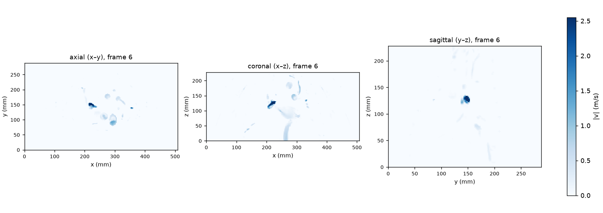

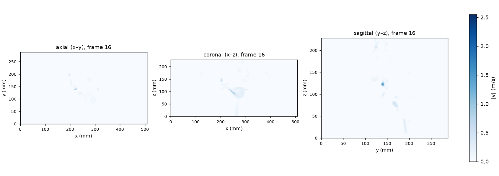

Zoom on the jet at peak systole: |v| and v_z.

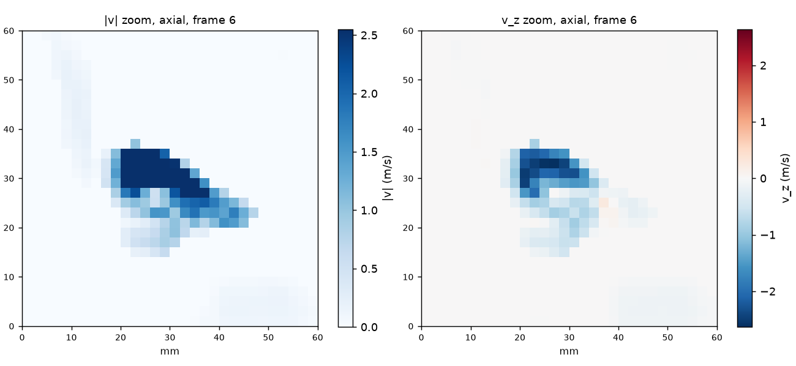

|v| across the jet: a 12 mm core plateau (4.3–4.9 m/s) and a hard edge (0 one voxel outside).

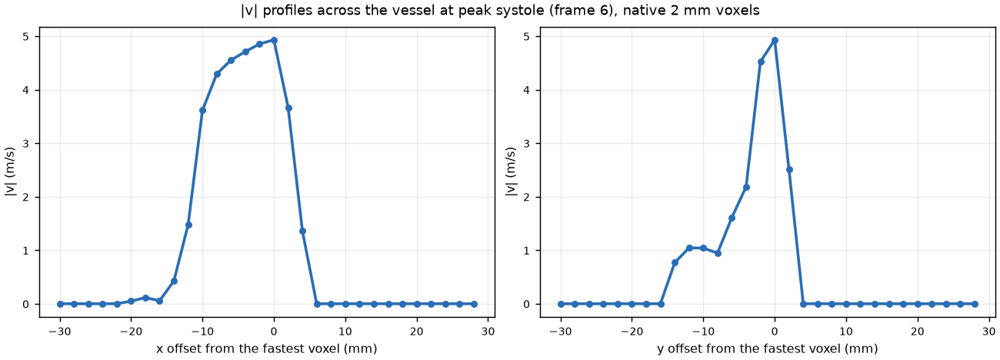

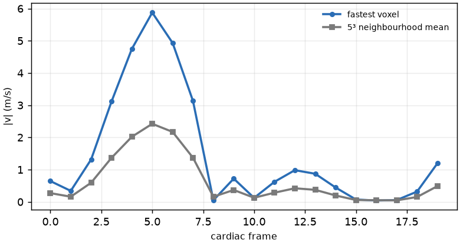

Descending aorta (≈ 20 mm lumen), axial cross-section 30 mm above the box bottom: a smooth, skewed profile (peak
0.79 m/s off-centre at frame 6), no concentric bands in the truth, velocity 0 one voxel outside the wall.

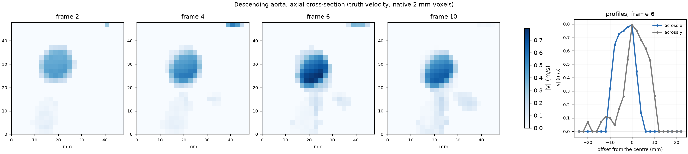

The same cross-section in two gated reconstructions (4 mm grid; native → recon voxel mapping approximate, GNL
ignored): the lumen is patchy, with a few hot voxels; no ringing bands at this slice.

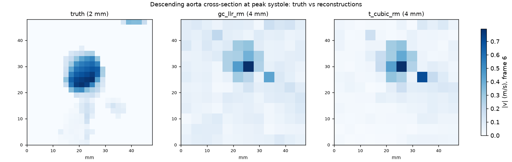

## Velocity-weighted MIPs (PC-angiogram style)

Script `truth_mip.py`. Rows: frames 0, 3, 6, 10, 16 and the time average; columns: MIP along y (coronal), x
(sagittal), z (axial); axes in mm.

1 mm fine truth (`truth_fine/truth4d.hv`, the flow field before any MR simulation): MIP of blood fraction × |v|.

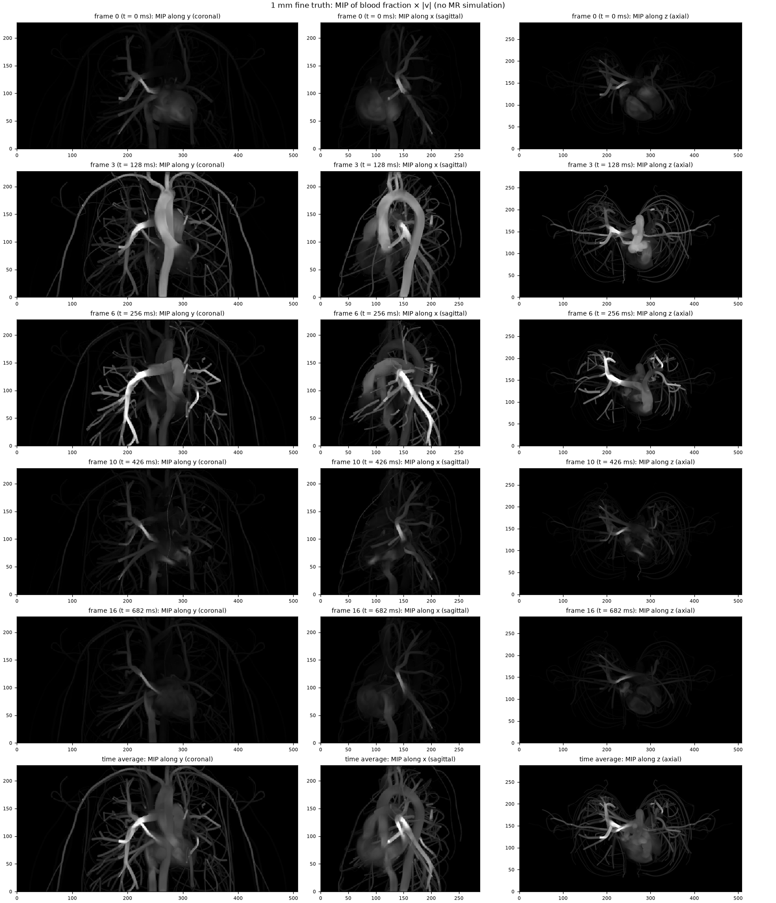

2 mm native truth: MIP of the simulated reference-encode magnitude (`truth_pc_signal.npz` c0_abs, spin history
included) × |v|. The native truth only covers the recon box (x ≈ 180–370 mm).

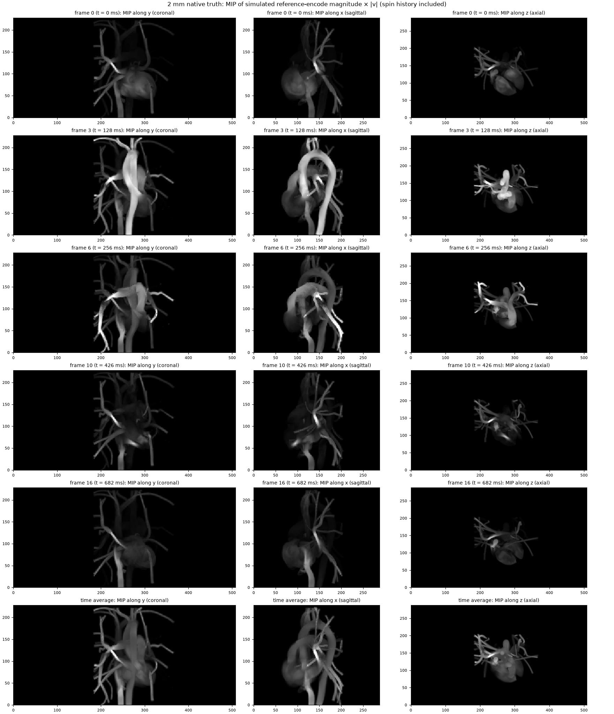

Zooms (`truth_mip_zoom.py`, 1 mm, slab MIPs): the right pulmonary artery at frame 6 (4–5 m/s down into the lower-lobe
branch), and the hilum at frame 0 (end-diastole), where a short pulmonary segment carries ~2 m/s.

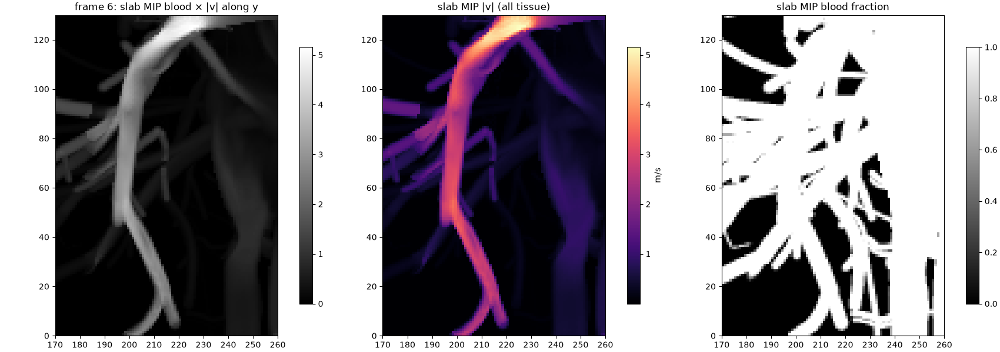

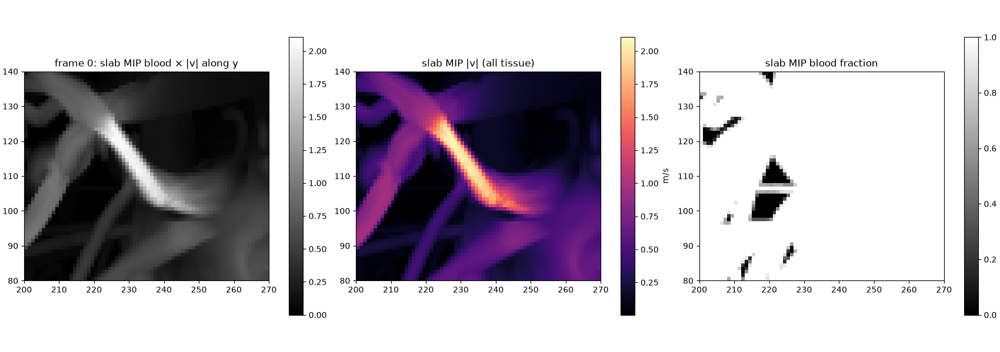

### Speeds per blood class (`truth_speed_by_class.py`, 1 mm, blood fraction > 0.5)

99th percentile / max |v| (m/s), selected frames:

| frame (ms) | LV | artery (systemic) | pulm. artery | pulm. vein | LA |
|---|---|---|---|---|---|
| 0 (0) | 0.82 / 0.98 | 0.15 / 0.31 | 0.73 / 1.58 | 0.99 / 2.11 | 0.83 / 1.64 |
| 3 (128) | 1.85 / 2.06 | 2.14 / 2.34 | 1.97 / 3.30 | 0.76 / 1.61 | 0.67 / 1.35 |
| 5 (213) | 1.82 / 1.93 | 1.52 / 1.83 | 3.13 / 6.21 | 0.69 / 2.01 | 0.50 / 1.18 |
| 6 (256) | 0.93 / 1.04 | 0.78 / 1.06 | 3.14 / 5.16 | 0.72 / 1.98 | 0.52 / 1.25 |
| 8 (341) | 0.23 / 0.31 | 0.60 / 1.06 | 1.88 / 5.88 | 0.23 / 0.76 | 0.38 / 0.66 |
| 11 (469) | 1.34 / 1.42 | 0.26 / 0.66 | 0.62 / 1.81 | 1.47 / 3.22 | 1.29 / 2.64 |

Physiological reference (adult, rest): pulmonary artery peak ≈ 0.6–1.0 m/s, pulmonary veins ≈ 0.4–0.6 m/s, aorta
≈ 1.0–1.5 m/s. The earlier chamber-only LBM (v22) had pulmonary p95 1.5 m/s.

Findings:
- **Pulmonary circulation too fast.** Pulmonary-artery p99 3.1 m/s and max 6.2 m/s in systole; 7 720 PA voxels
  > 2 m/s at frame 5. Even in diastole (frame 8, when the right-PA flux is only 65 mL/s) 1 053 PA voxels
  are > 2 m/s, max 5.9 m/s at (z, y, x) = (90, 123, 184) — x = 184 mm is next to the recon box's
  lateral edge.
- **The right-PA flux is plausible** (peak 245 mL/s, gates.json `vessel_flux_ml_s`), so the speeds come from local
  geometry or boundary effects, not from too much flow.
- **Pulmonary veins at 2–3 m/s on a few voxels all cycle long** (waveform at the fastest one: 2.1, 2.4, …, 3.2 m/s at
  469 ms). They sit at (z, y, x) ≈ (118–129, 139–142, 224–227), touching the systolic PA maximum at (125, 150, 226).
- **Hypothesis (to test with `lbm_leaks.py` on a `--snap` snapshot, not yet confirmed):** a PA→PV leak through a
  wall gap at the hilum. A pressure-driven shunt flows all cycle, which matches the bright segment in every frame.
  Separately, the diastolic hot spots at the box edge point to an outlet/connector boundary effect.
- **Aorta peaks at 128–171 ms, the right PA at 213 ms** (~50 ms later; physiologically RV and LV ejection overlap
  closely). The thoracic aorta also shows sustained retrograde flux (−15 to −29 mL/s for ~250 ms in diastole).
- **No concentric ("cylindrical") bands** were found in these truth images. Velocity steps along vessels occur at
  branchings.
