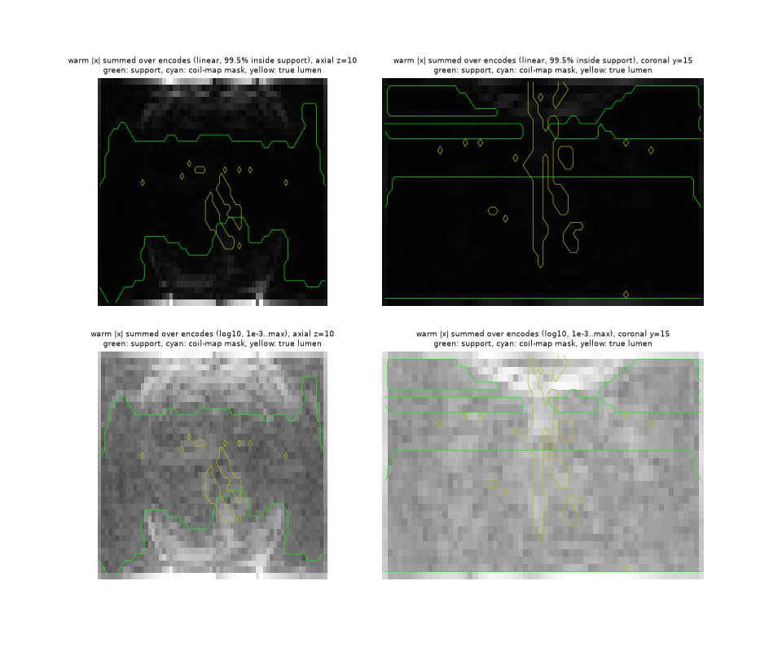
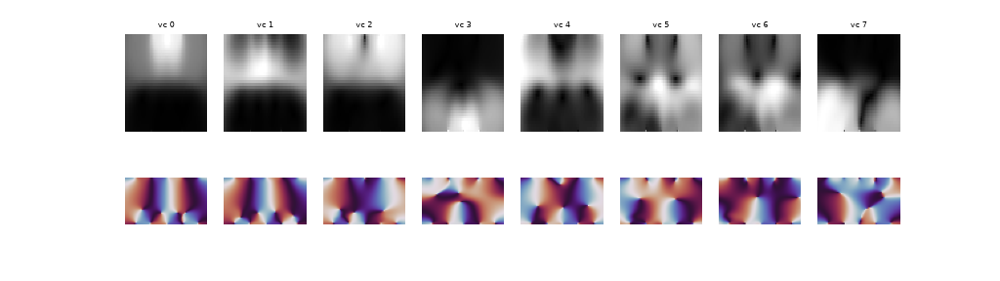
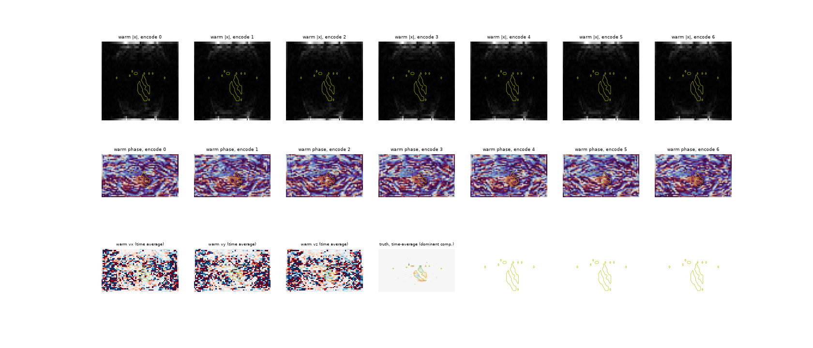
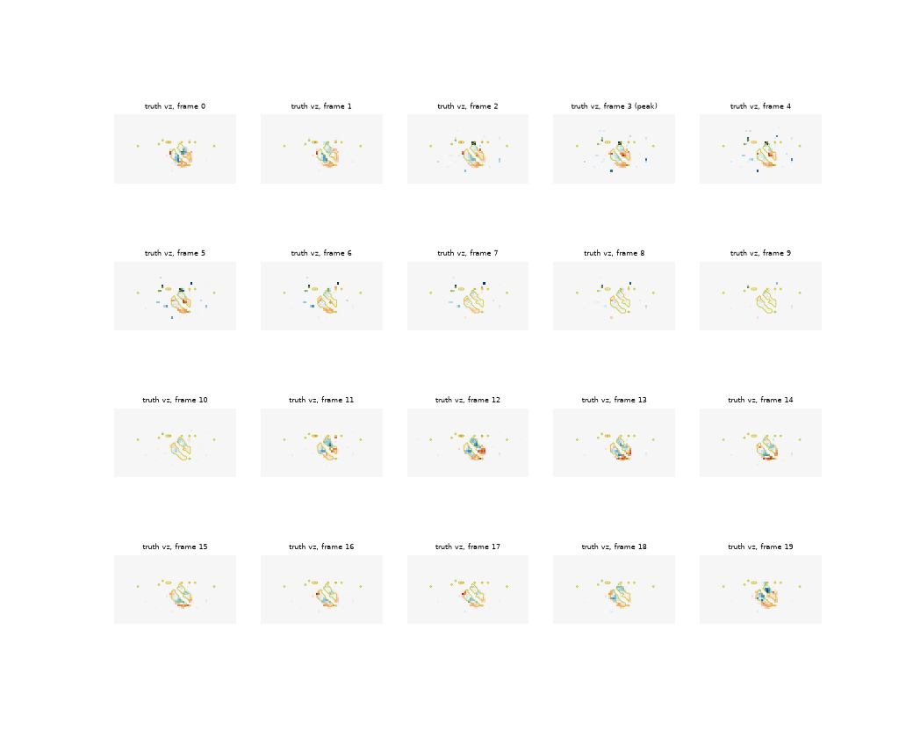
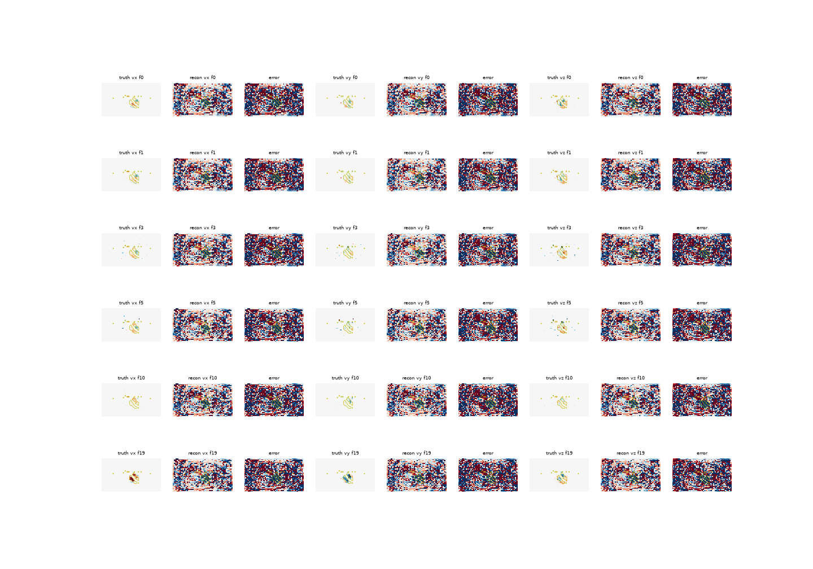
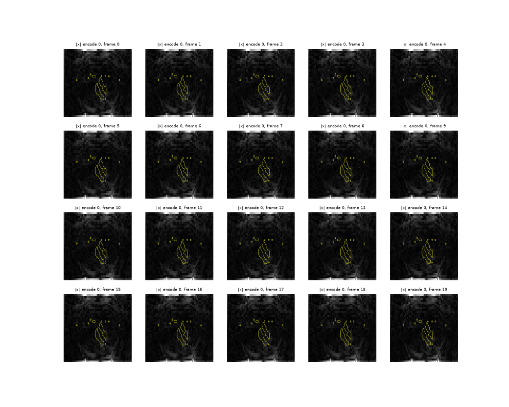
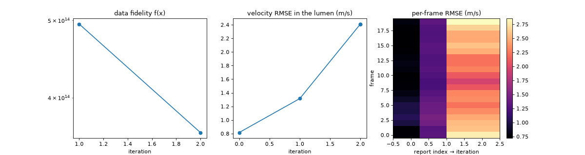
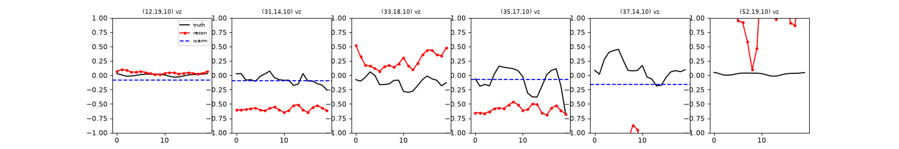
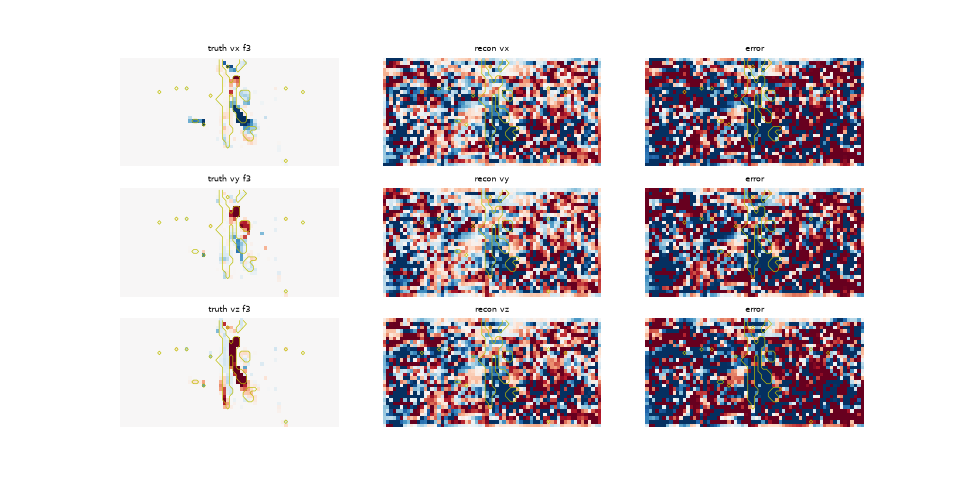

# smoke8mm

`/home/turbotage/Documents/GitHub/HastyCompute/rustlib/target/snap_b0/recon_p2np_rmbc data/hasty/phantom/factory_arms/ph0001/sim_flow_10min/scan --vmodel knots --vop knots --ratemap truth-bc --resp bellows --gnl --phys full --conc-fit deg4 --nseg 6 --vcoils 8 --keep 8 --grid-scale 0.25 --kcrop --warm 4 --iters 2 --vcont 2 --vinit cg:3 --precond zmshr1m --every 1 --lam-iters 2 --static-lock 20:2:1 --out /home/turbotage/Documents/GitHub/HastyCompute/research/experiments/ratemap_bc/smoke8mm`

## 01_masks.png
Object support (green) and coil-map mask (cyan) over the warm-start magnitude; true lumen in yellow. The lumen must lie inside the coil-map mask.

## 02_coilmaps.png
Virtual coil maps (magnitude top, phase bottom), axial slice z = 10, after normalisation and masking.

## 03_warm.png
Warm start (time-averaged PCGLS per encode): magnitude, phase, velocity vs the time-averaged truth.

## 04_truth.png
Truth velocity (component z, the dominant one in this slice) for every frame.

## 10_seg_zmshr1m_vk6x16_r1c3_c2_lockq20i2e1_velocity.png
seg_zmshr1m_vk6x16_r1c3_c2_lockq20i2e1: velocity per frame (truth / recon / error, all components), axial z=10; peak systole = frame 3.

## 11_seg_zmshr1m_vk6x16_r1c3_c2_lockq20i2e1_magnitude.png
seg_zmshr1m_vk6x16_r1c3_c2_lockq20i2e1: reconstructed magnitude of the reference encode, every frame.

## 12_seg_zmshr1m_vk6x16_r1c3_c2_lockq20i2e1_convergence.png
seg_zmshr1m_vk6x16_r1c3_c2_lockq20i2e1: convergence (fidelity, lumen velocity RMSE, per-frame RMSE).

## 13_seg_zmshr1m_vk6x16_r1c3_c2_lockq20i2e1_curves.png
seg_zmshr1m_vk6x16_r1c3_c2_lockq20i2e1: velocity-time curves at six lumen points (dominant component).

## 14_seg_zmshr1m_vk6x16_r1c3_c2_lockq20i2e1_coronal.png
seg_zmshr1m_vk6x16_r1c3_c2_lockq20i2e1: coronal slice y=15 at peak systole.

