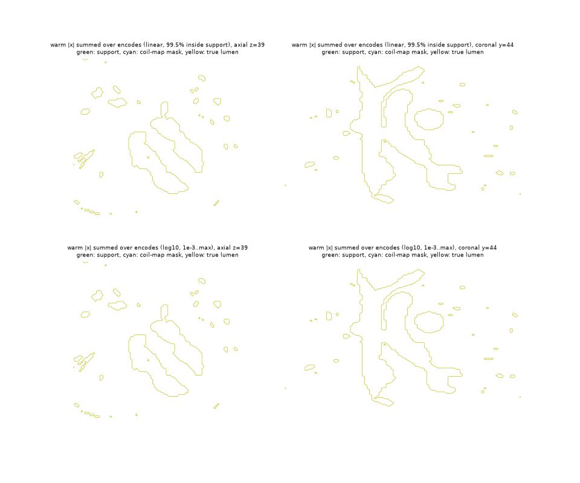
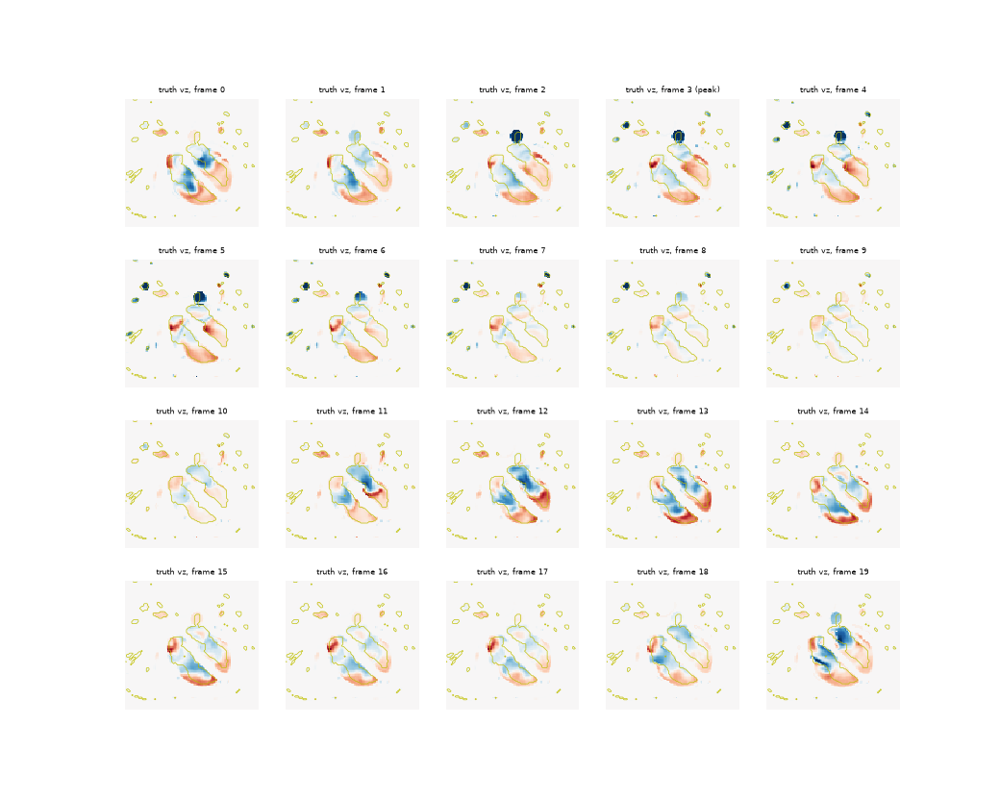

# p2np_box

`/home/turbotage/Documents/GitHub/HastyCompute/rustlib/target/rcompress_snap/recon_p2np data/hasty/phantom/factory_arms/ph0001/sim_flow_10min_box1mm_b/scan --grid-scale 0.5 --kcrop --keep 4 --iters 3 --every 1 --kappa 0 --no-full-save --fresh --rcompress box --out research/experiments/sample_compress/out/drivers/p2np_box`

## 01_masks.png
Object support (green) and coil-map mask (cyan) over the warm-start magnitude; true lumen in yellow. The lumen must lie inside the coil-map mask.

## 02_coilmaps.png
Virtual coil maps (magnitude top, phase bottom), axial slice z = 39, after normalisation and masking.

## 04_truth.png
Truth velocity (component z, the dominant one in this slice) for every frame.

