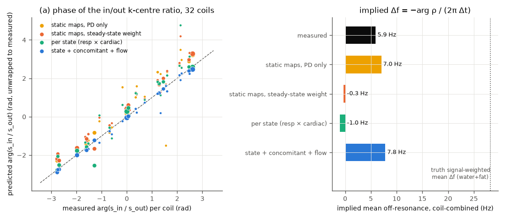
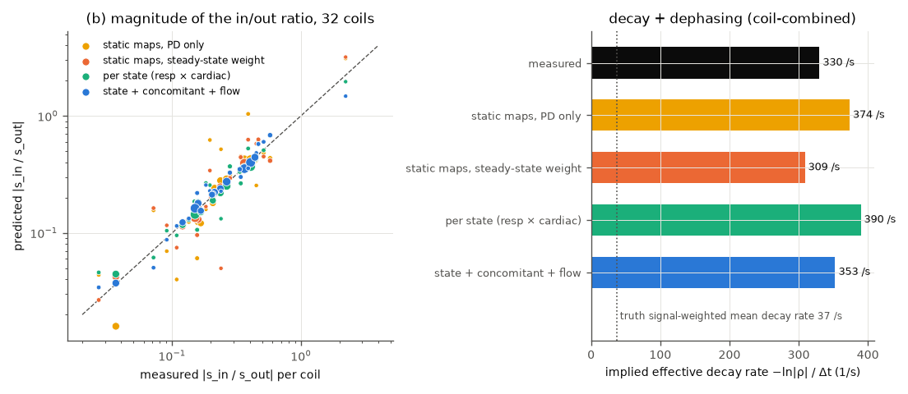
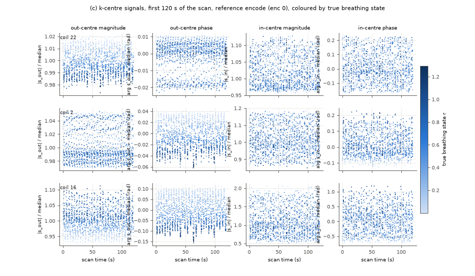
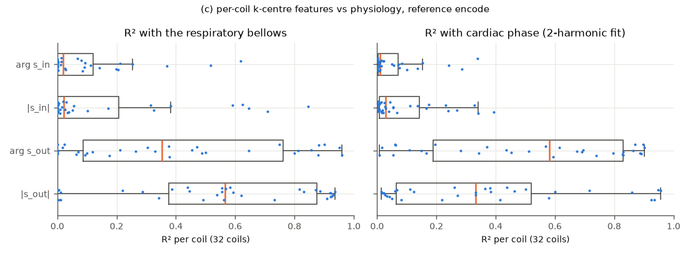
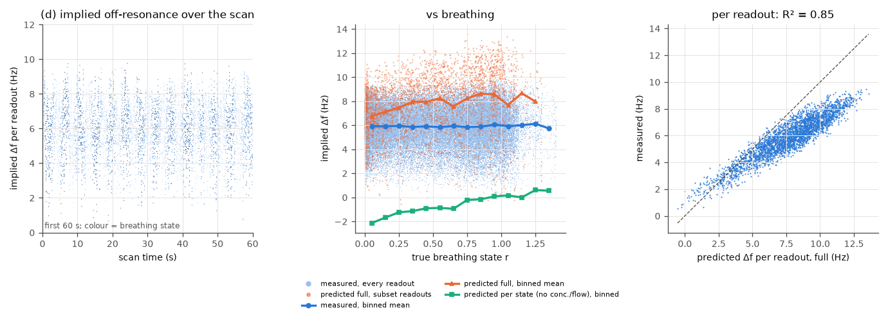
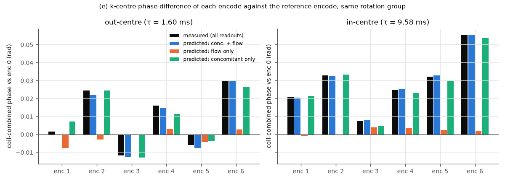

# The k-centre figures, explained (2026-11-23)

Figures: `research/experiments/kcentre/figs/`. Full numbers: `research/kcentre_signals.md`.

## What is measured

Every readout of the yarn passes through $k = 0$ twice:
- at the **start of the ADC**, $t_1 = 1.600$ ms after excitation (going *out*);
- at the **end of the return half**, $t_2 = 9.578$ ms after excitation (coming back *in*).

At $k = 0$ there is no spatial encoding, so each coil $c$ records one complex number, the coil-weighted sum over the
whole excited slab:

$$
s_c(t) = \sum_x S_c(x)\, m(x)\, e^{-R(x)(t - t_0)}\, e^{-i 2\pi \Delta f(x)(t - t_0)} \quad (\text{+ fat, concomitant and flow phase}),
$$

- $S_c$: the coil map;
- $m$: the magnetisation (water + fat);
- $R$: the decay rate;
- $\Delta f$: the off-resonance.

So there are 32 numbers per readout and per pass, every TR (11.3 ms).

The analysis uses the ratio of the two passes, per coil and readout:

$$
\rho_c = \frac{s_c(t_2)}{s_c(t_1)}, \qquad \Delta t = t_2 - t_1 = 7.98\ \text{ms}.
$$

If every voxel seen by the coil had the same $\Delta f$ and $R$, then exactly $\rho = e^{-R\Delta t}\, e^{-i 2\pi \Delta f \Delta t}$.
That gives two "implied" quantities:

$$
\Delta f_{\text{impl}} = -\frac{\arg \rho}{2\pi \Delta t} \quad (\text{wraps every } 1/\Delta t \approx 125\ \text{Hz}),
\qquad
R_{\text{eff}} = -\frac{\ln|\rho|}{\Delta t}.
$$

When $\Delta f$ varies across the voxels a coil sees, the sum *dephases*: $|\rho|$ drops even without decay. So
$R_{\text{eff}}$ is decay plus dephasing.

**Four predictions from the phantom truth** (comparison only; nothing here feeds a method):
1. **static maps, PD only:** one time-averaged image (proton density), the truth field and decay rate.
2. **static maps, steady-state weight:** the same, with each voxel weighted by its steady-state signal (T1, flip
   angle).
3. **per state (resp × cardiac):** the truth images and field of each breathing × cardiac state at each readout's
   time.
4. **state + concomitant + flow:** (3) plus the concomitant (Maxwell) phase of the actual gradients and the flow phase.
   This is the most complete model.

## Figure (a): phase of the in/out ratio

- **Left:** each point is one coil (32 per colour), with $\arg\rho_c$ averaged over all readouts. x = measured,
  y = predicted, one colour per prediction. On the dashed line, prediction = measurement. Point size is the coil's
  signal weight.
  - The blue points (full model) lie on the line. The others scatter more, especially for coils with a phase near $\pm\pi$.
- **Right:** the same as one coil-combined number, $\Delta f_{\text{impl}}$ in Hz.
  - Measured 5.9 Hz, full model 7.8 Hz. Without concomitant and flow the prediction is −1.0 Hz; static PD-only gives
    7.0 Hz, by chance close.
  - The dotted line is the truth's signal-weighted mean off-resonance, 28 Hz. **No bar is near it.**
- **Take-away:** the ratio phase is not "the mean B0".
  - Fat is $\approx 54\,\%$ of the signal weight, shifted $\approx -440$ Hz, so it rotates $440 \cdot 7.98\cdot 10^{-3} \approx 3.5$
    turns in $\Delta t$.
  - The concomitant phase adds $\approx +10$ Hz equivalent.

  Both dominate the ratio phase. Turning it into a B0 estimate requires a model with fat and the concomitant field.

## Figure (b): magnitude of the in/out ratio

- **Left:** as (a) but for $|\rho_c|$, log scale. Again, the full model (blue) lies closest to the line.
- **Right:** coil-combined $R_{\text{eff}} = -\ln|\rho|/\Delta t$. Measured $330\ \text{s}^{-1}$, predictions
  $309$–$390\ \text{s}^{-1}$. The dotted line is the truth's signal-weighted mean decay rate, $37\ \text{s}^{-1}$.
- **Take-away:** $e^{-37 \cdot 0.00798} \approx 0.74$ would be the decay-only ratio; the measured $|\rho| \approx e^{-330 \cdot 0.00798}
  \approx 0.07$. About 90 % of the loss (in $\ln|\rho|$) is dephasing: water–fat beating, field spread across the
  slab, concomitant phase. The magnitude ratio is therefore a poor direct decay-rate estimate.

## Figure (c): signals over the scan

- 4 columns: $|s_{\text{out}}|$, $\arg s_{\text{out}}$, $|s_{\text{in}}|$, $\arg s_{\text{in}}$, each relative to its
  median. 3 example coils (rows).
- x: the first 120 s of the scan; reference encode only. Colour: the true breathing state $r$ (light = low, dark =
  high).
- **Out-centre (left two columns):** clear horizontal bands sorted by colour. The k-centre signal of each coil moves
  with breathing by a few % in magnitude and up to $\approx 0.1$ rad in phase.
- **In-centre (right two columns):** the colour bands are gone, and the scatter is large (magnitude 0.5–2× on coil 16).
  The rotation-dependent concomitant phase accumulated between $t_1$ and $t_2$ hides the breathing.

## Figure (c2): how well each signal tracks physiology

- One dot per coil: the $R^2$ of the feature (rows) against
  - the respiratory bellows (left);
  - the cardiac phase (right, a fit with 2 harmonics, $a_0 + \sum_{h=1}^{2} a_h\cos 2\pi h\phi + b_h \sin 2\pi h\phi$).
- The box spans the middle 50 % of the coils; the orange bar is the median.
- **Out-centre:** median $R^2 \approx 0.57$ (magnitude) and $0.35$ (phase) with breathing, and $\approx 0.95$ on the
  best coils. Cardiac phase gives median $\approx 0.58$ (phase) and up to $0.96$.
- **In-centre:** median $R^2 \approx 0.02$ for both.
- **Take-away:** the out-centre samples are a free respiratory and cardiac navigator, 32 channels every TR. The
  in-centre samples are not, unless the concomitant phase is modelled out.

## Figure (d): implied off-resonance over time and against breathing

- **Left:** $\Delta f_{\text{impl}}$ for every readout over the first 60 s (colour: breathing state). It spreads over
  $\approx 2$–$10$ Hz from readout to readout.
- **Middle:** $\Delta f_{\text{impl}}$ against the true breathing state $r$.
  - Blue: measured (dots per readout, line = binned mean).
  - Orange: the full prediction.
  - Green: the per-state prediction without concomitant and flow.
  - **The measured mean is flat ($\approx 6$ Hz) over the whole breathing range, while both predictions rise by
    $\approx 1.6$–$2.2$ Hz per unit of $r$.**
- **Right:** measured against the full prediction per readout. $R^2 = 0.85$: the readout-to-readout spread is explained,
  and it comes from the concomitant phase changing with the readout's rotation. The slope is below 1 (the prediction
  overshoots at high values).
- **Take-away / open point:** the readout-to-readout variation is understood. The missing breathing dependence is
  NOT: the truth ratemaps say the field changes with breathing, the data say it does not.
  - Checked 2026-11-23 (correction of the guess that stood here):
    - `sim_flow_10min` was simulated (2026-11-09..17) before simphantom's `--resp-field` existed (2026-11-18, default
      off). Every tissue source keeps one off-resonance ω (the reference-pose field at its own position) and carries it
      as it moves: the field moves with the tissue, but lung inflation never changes it. Summed over all sources, the
      k-centre signal then barely depends on breathing. The flat measurement is what this simulation contains.
    - Its `truth_ratemap_bc` was made with `--advected-only`: the same advected field, so it matches the data. The
      rising "per state" prediction comes from my prediction, which uses each 2 mm voxel's PD-weighted mean ω instead
      of the sources (not verified further).
    - The dev recon uses neither: `--field truth` is one static map (field_ppm_recon) for every frame. Against the
      per-state advected field it is off by p95 38 Hz at end-expiration up to 167 Hz at the deepest breathing state
      (signal-weighted), i.e. p95 0.23–1.0 rad at the end of the 0.96 ms dev readout window.
    - Real breathing fields (lung inflation: liver 4–15 Hz median, up to 20–40 Hz; research/resp_field_sim.md) are only
      in the 120 s dev scan `sim_flow_dev_respfield`, not in the 10 min scan.

## Figure (e): per-encode k-centre phase

- The coil-combined phase difference $\arg s^{(e)} - \arg s^{(0)}$ of each velocity encode $e = 1,\dots,6$ against the
  reference encode, for readouts of the same rotation group, at $t_1$ (left) and $t_2$ (right).
- Bars:
  - black: measured;
  - blue: predicted, concomitant + flow;
  - orange: flow only;
  - green: concomitant only.
- Measured and blue agree to $\approx 0.002$ rad. The differences are small ($-0.012$ to $+0.055$ rad) and mostly
  concomitant phase from the encoding gradients. Flow contributes $\le 0.007$ rad: 2–20 % typically, up to
  $\approx 50\,\%$ where the concomitant part is small. In encode 1, at $t_1$, they cancel.
- **Take-away:** the k-centre gives a near-exact check of the encode-dependent concomitant model. It says little about
  flow on its own: flow is a small part of the whole-slab average.

## Summary

| use of the k-centre samples | works? | needs |
|---|---|---|
| respiratory / cardiac navigator ($t_1$ samples) | yes: $R^2$ up to 0.95 per coil | nothing extra |
| B0 / ratemap from the two passes | only with a model | fat + concomitant phase in the model; wraps every $1/\Delta t \approx 125$ Hz |
| decay rate from $\lvert\rho\rvert$ | poorly | dephasing dominates |
| check of the concomitant model per encode | yes, to $\approx 0.002$ rad | — |
| check of coil maps per readout | yes: 6–8 % residual with the truth maps | — |
| simulator check: does the field move with breathing? | **flags a mismatch** | look at simphantom |

Not available yet: ADC samples during the velocity encoders and spoilers. The simulator does not record them. That is
being added now, to the sequence and the simulator.
