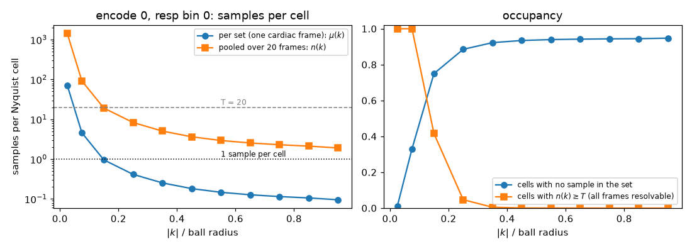
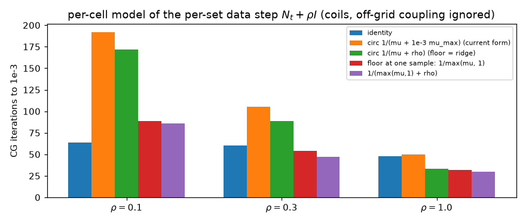

# What form should the preconditioner take for our sampling? (2026-11-23)

Scope: the production-like dev configuration.
- Out-half ADC.
- All 53 144 readouts.
- 4 respiratory bins × 20 cardiac frames × 7 encodes = 560 sets.
- 128 × 72 × 60 grid, `--kcrop`.
- 31 virtual coils.
- Prior: LLR + wavelet + DFW + static lock.

Scripts and numbers: `research/experiments/precond_theory/`.

## 0. What we found before (recap)

| finding | where | status |
|---|---|---|
| On a quadratic, PCG in a fixed metric $P$ beats every gradient-only method in the same metric (Theorem K). The metric is the big lever, and rank-one dynamic updates (ZMSHR1) alone cannot carry a $10^6$ density spread. | convergence_strategy.md §0 | theory + toy |
| A preconditioner leaves the estimator unchanged only for a strictly convex objective solved to convergence. With (near-)null directions PCG converges to the minimum-$\lVert\cdot\rVert_{P^{-1}}$ solution. | precond_estimator.md §1 | proved |
| In PnP with a Euclidean denoiser the metric changes the fixed point (Proposition G; the "metric displacement" theorem). | learned_prior_cs_theory.md, pnp_restricted paper | proved |
| The current circulant metric `zmshr1m` ($D^{-1/2}\,\mathcal F^{-1}(\lambda+\varepsilon)^{-1}\mathcal F\,D^{-1/2}$, $\varepsilon = 10^{-3}\lambda_{\max}$) is harmful in the production-like run: the held-out residual has its minimum at iteration 20, then rises; pc RMSE 0.410 at it 60. | precond_compare/results.md | measured |
| No metric / Jacobi / a bounded circulant are about equal (pc RMSE 0.27–0.28 at it 60) and slow (still improving at 120). No metric + step guard + out-half coil calibration: held-out 0.0613, pc RMSE 0.258 at 60. | same | measured |
| Hypotheses that did NOT hold: the field-gradient k-shift (measured on the full ADC), a physics-probed circulant symbol (P1), deflation with unconverged Ritz vectors. | precond_estimator.md §6–7 | refuted / dropped |

## 1. The sampling, measured

Samples per Nyquist cell ($1/\mathrm{FOV}$ per axis) for one (encode, respiratory bin) group:
- $n(k)$: pooled over its 20 cardiac frames;
- $\mu(k) = n(k)/T$: the expected count per set (one frame);
- the fraction of cells a set leaves empty.

The other groups are identical to 1 %.

| $\lvert k\rvert$ / ball radius | 0–0.05 | 0.05–0.1 | 0.1–0.2 | 0.2–0.3 | 0.3–0.5 | 0.5–1.0 |
|---|---|---|---|---|---|---|
| pooled $n(k)$ | 1432 | 92 | 19 | 8.3 | 3.6–5.1 | 1.9–2.9 |
| per set $\mu(k)$ | 72 | 4.6 | 0.96 | 0.42 | 0.18–0.25 | 0.10–0.15 |
| cells empty in a set | 1 % | 33 % | 75 % | 89 % | 92–93 % | 94–95 % |

So a set is **dense** ($\mu \ge 1$) only inside $\lvert k\rvert \lesssim 0.15$ of the ball radius. Beyond that, a set is a
**sparse, random** scatter of single samples: about one occupied cell in ten to twenty. Even pooled over the 20 frames,
a cell beyond $0.2$ holds fewer samples than there are frames.

In the temporal direction this means: at a cell $k$ the data term of one group is $\sum_t n_t(k)\,\lvert \hat x_t(k)-\hat y_t(k)\rvert^2$.
Its $T\times T$ Hessian is $\mathrm{diag}(n_t(k))$, which has rank $\#\{t : n_t(k)>0\} \approx T(1-e^{-\mu(k)})$. Beyond
$0.2$ of the radius that is about 1–3 of the 20 temporal degrees of freedom. **The data determine the temporal mean
there; the temporal detail must come from the prior.** No preconditioner changes that. It is the compressed-sensing
regime, and the prior is part of the problem's conditioning, not an add-on.

## 2. Why a density-inverse metric is wrong inside P²nP

P²nP iterates $x \leftarrow D\!\left(x - \alpha P \nabla f(x)\right)$ with a Euclidean denoiser
$D = \operatorname{prox}_{\lambda R}$ (LLR, wavelet shrinkage and the lock are proxes or averages of proxes). A fixed
point satisfies

$$
x - \alpha P\nabla f(x) - x \in \lambda\,\partial R(x)
\quad\Longleftrightarrow\quad
\nabla f(x) + \tfrac{\lambda}{\alpha}\,P^{-1} g = 0 \ \text{ for some } g \in \partial R(x).
$$

The prior's subgradient is reweighted by $P^{-1}$. With $P = (\text{density})^{-1}$, the prior is weakened by
$\mu(k)/\mu_{\max} \approx 10^{-3}$ at high $k$ relative to the centre. That is exactly the estimator of a
density-compensated data term (DCW) with the original prior.
- At high $k$ a set holds single samples (§1), so the fixed point fits single noisy samples there.
- This matches the production run: the held-out residual is lowest at iteration 20 and rises afterwards, and pc RMSE is
  0.410 vs 0.258.

**Conclusion 1.** Inside P²nP (fixed-strength Euclidean denoiser) the metric must be close to a scalar on the
subspace where the prior acts. Otherwise it changes the estimator. A strong preconditioner needs an algorithm whose
fixed point does not depend on it:
- **ADMM / HQS**, with the per-set data step solved by PCG;
- or the RED/Moreau objective with a metric method (convergence_strategy.md §0.4).

The fixed point of ADMM is the minimiser of $f + \lambda R$, independent of the inner preconditioner and of $\rho$,
when $D = \operatorname{prox}_{(\lambda/\rho)R}$ with the threshold scaled by $1/\rho$. This holds for proxes of convex
functions and their averages (proximal average); the composition LLR → lock → DFW is not exactly a prox, so the
invariance there is approximate.

## 3. The data step and its best diagonal metric

ADMM's data step is per set and strictly convex:

$$
x_t = \arg\min_x \tfrac12 \lVert E_t x - y_t\rVert^2 + \tfrac\rho2 \lVert x - v_t\rVert^2,
\qquad H_t = N_t + \rho I .
$$

**Per-cell model** (coils folded into $D=\sum_c\lvert S_c\rvert^2$, samples snapped to cells):
$H_t \approx D^{1/2}\,\mathcal F^{-1}\,\mathrm{diag}\big(n_t(k) + \rho\big)\,\mathcal F\, D^{1/2}$. Its spectrum has three
parts:
- **empty cells:** $\rho$ (most of k-space);
- **sparse occupied cells:** $1+\rho,\ 2+\rho,\dots$ These are *integer clusters*, at every $\lvert k\rvert$;
- **dense centre:** a continuum around $\mu(k)+\rho$, up to $\approx 72+\rho$.

A metric diagonal in $k$, $P = D^{-1/2}\mathcal F^{-1}\mathrm{diag}(p(k))\mathcal F D^{-1/2}$, can only use the smooth
$\mu(k)$; which cells a set occupies is random. Then:
- **$p = 1/(\mu+\varepsilon)$ (the current form)** multiplies the integer clusters by $1/\mu(k)$, which varies 10–30×
  over the sparse region. That smears the clusters into a continuum. CG converges in about as many iterations as there
  are clusters, so this is *slower than no metric*.
- **$p = 1$ (no metric)** keeps the clusters, but the dense centre ($\mu$ up to 72) sets $\lambda_{\max}$.
- **$p = 1/(\max(\mu,1)+\rho)$, "density compensation clipped at one sample per cell per set"**, compresses only the
  dense centre and leaves the sparse region scalar. That is the right form by construction: it inverts $\mu$ exactly
  where $N_t \approx \mu(k)\,I$ is a good model (dense), and nowhere else.

CG on the measured per-cell spectra (one group, random right-hand side, iterations to $10^{-3}$):

| metric | $\rho=0.1$ | $\rho=0.3$ | $\rho=1$ |
|---|---|---|---|
| none ($p=1$) | 64 | 60 | 48 |
| current form $1/(\mu+10^{-3}\mu_{\max})$ | 192 | 105 | 50 |
| $1/(\mu+\rho)$ | 172 | 89 | 33 |
| $1/\max(\mu,1)$ | 89 | 54 | 32 |
| **$1/(\max(\mu,1)+\rho)$** | 86 | **47** | **30** |

($\rho$ is in units of one sample's energy per cell.)

What the model says:
- **The current density-inverse form is the worst** for small $\rho$, 3× slower than no metric.
- **Clipping at one sample per cell per set** is the best form, with a moderate gain over no metric (48 → 30 at
  $\rho=1$).
- **The bigger lever is $\rho$ itself.** In the sparse region the inner condition number is $(1+\rho)/\rho$, so
  $\rho \sim 1$ sample-energy gives a well-conditioned data step. That is the scale at which "one sample" and "the
  prior's pull" balance.

**Caveat (model, not measurement).** Real $N_t$ is not diagonal in $k$:
- off-grid samples couple neighbouring cells;
- the coil maps couple cells within their $k$-width;
- the 2026-11-22 toy showed coil structure is the leading mismatch of any coil-collapsed model.

The structural statements carry over; the iteration counts do not. In particular: the sparse region wants a scalar
metric, the dense centre a density inverse, and the floor is set by $\rho$. The clip should use the coil-smoothed
count $\mu(k)$ (its scale is the coil maps' $k$-width).

## 4. Recommended form

1. **Algorithm: ADMM (or HQS).**
   - The data step is per set: K inner PCG iterations on $N_t+\rho I$, warm-started, $K \approx 3$–$5$.
   - The prior step is the existing denoiser (LLR + wavelet + DFW + lock), with thresholds scaled by $1/\rho$.
   - The estimator does not depend on the preconditioner. That is what the user wants from "precondition, never DCW",
     and P²nP cannot provide it.
2. **Inner preconditioner:**
   $$
   P_t = D^{-1/2}\,\mathcal F^{-1}\,\mathrm{diag}\!\Big(\frac{1}{\max(\tilde\mu_t(k),\,1) + \rho}\Big)\,\mathcal F\,D^{-1/2},
   $$
   - $\tilde\mu_t$ is the set's expected count per cell, smoothed on the coil $k$-width (one Chan symbol per encode ×
     respiratory group, scaled by the set's readout count);
   - $D = \max\big(\sum_c\lvert S_c\rvert^2,\ \text{floor}\big)$.
   - Cost: one single-image FFT pair per application, as today's metric.
3. **$\rho$:** about one sample-energy per cell (the cell energy of one sample summed over coils). Adapt it by
   residual balancing ($\lVert$primal$\rVert$ vs $\lVert$dual$\rVert$). Then the sparse region's inner $\kappa \approx 2$.
4. **Cost per outer iteration:** $K$ gradients + one denoise. Today a gradient is 17 s and a denoise 29 s, so $K=3$
   gives about 80 s per outer iteration vs 48 s for P²nP. ADMM wins if it needs ≲ 0.6× as many outer iterations as
   P²nP needs iterations; P²nP is still improving at 120.

## 5. Test (production config, pre-registered)

- Arms:
  - ADMM with $K = 3$, $\rho$ at one sample-energy, the clipped metric of §4;
  - ADMM with no inner metric (same $\rho$, $K$);
  - the reference: P²nP with no metric + step guard 2 (`g_esp`: held-out 0.0613, pc RMSE 0.258 at it 60).
- Same prior strengths and pooled start.
- Measure wall time to the held-out plateau and the pc score.
- Estimator check: the two ADMM arms converge to the same image (relative difference below the held-out noise floor).
- Decision: ADMM + clipped metric becomes the default for the complex model if it reaches the reference quality in
  ≤ 0.6× the wall time and the estimator check holds.

## 6. Implementation (2026-11-23)

`recon_p2np --prior-mode admm` (library `hasty_recon::admm`; defaults of the other modes unchanged).

| switch | meaning |
|---|---|
| `--admm-rho R` | $\rho = R\,\rho_1$ (default 1) |
| `--admm-rho-adapt` | residual balancing: $\rho \to 2\rho$ / $\rho/2$ by the 10× rule, $u$ rescaled; dual residual in units of $\rho_1$, $(\rho/\rho_1)\lVert z - z_{\text{prev}}\rVert$ |
| `--admm-inner K` | inner PCG iterations per set (default 3) |
| `--admm-metric none\|clip` | inner metric (default none); clip = §4 |

- **Data step.** Per set, on the device: $x_t$, $v_t = z_t - u_t$, five PCG vectors and the set's staged data. One
  residual with the data, then $K$ applications of $N_t$ alone. $f(x)$ and $\nabla f(x)$ are carried by the exact
  recurrences, so the data term of the new $x$ costs nothing. Host state: $x, z, u$ plus one work stack for
  $D(x+u)$, i.e. four stacks, the same as P²nP's host state.
- **Prior step.** $z = D(x+u)$ with the same pipeline as P²nP (LLR + wavelet mix, DFW, static lock). The thresholds are
  re-estimated from the input $x + u = z - \nabla f(z)/\rho$. Where $\hat\sigma$ is set by the data-gradient part
  ($\propto 1/\rho$), $\tau = \kappa\hat\sigma \propto 1/\rho$ already, so $\lambda = \rho\tau$ does not move
  with $\rho$. There is therefore no κ rescaling; κ keeps its meaning. A fixed point of ADMM is a fixed point of
  P²nP-PGD with step $1/\rho$ and no metric.
- **$\rho_1$.** Per-cell model $N_t \approx D^{1/2}\mathcal F^{-1}\operatorname{diag}(c\,n_t)\mathcal F D^{1/2}$,
  $D = \sum_c\lvert S_c\rvert^2$. Its trace is $c\,m_t\bar D$; the operator's trace is
  $\sum_j\sum_n D(n)\,\lvert\text{phys}_j(n)\rvert^2$ for the unnormalised NUFFT. Hence $c = n_v \times$ (the
  samples' mean physics attenuation), and $\rho_1 = c\,D_{\text{body}}$ (median over the support).
  - At setup, $c$ is measured by a Hutchinson trace (4 sets × 4 probes).
  - It is then checked on plane waves: $\langle e_k, N_t e_k\rangle$ against $c\,\bar D\,\tilde\mu_t(k)$ at
    $k = 0$ and at an isolated one-sample cell at 0.5–0.9 of the ball radius.
- **$\tilde\mu$.** The per-encode Chan symbol (all sets pooled), convolved with the coil power spectrum, normalised
  to samples per cell: $\tilde\mu = m\,\lambda_{\text{conv}} / (\bar D \sum_k \lambda_{\text{Chan}})$. It is
  then scaled by the set's sample share. The fraction of cells with $\tilde\mu \ge 1$ is printed per encode.
- **Tests (CPU, per-cell Fourier model, elastic-net prox).** Metric none vs clip reach the same fixed point
  ($1.2\cdot10^{-7}$), and both match the FISTA minimiser to its own accuracy ($4.4\cdot10^{-6}$). $\rho \in
  \{0.3, 1, 4\}\,\rho_1$ with the threshold $\lambda/\rho$ give the same fixed point ($\le 4.4\cdot10^{-7}$).
  Residual balancing gives the same fixed point. The clip symbol is SPD with whitened spectrum $1/\lambda_{\text{eff}}$.
- **GPU test** `tests/admm_gpu.rs`: the device data step against a host reference (per-set PCG through the streamed
  gradient), and one outer iteration; it also checks $c = n_v$ for a phase-only model.
- Runs: `research/experiments/admm/run_admm.sh`.
