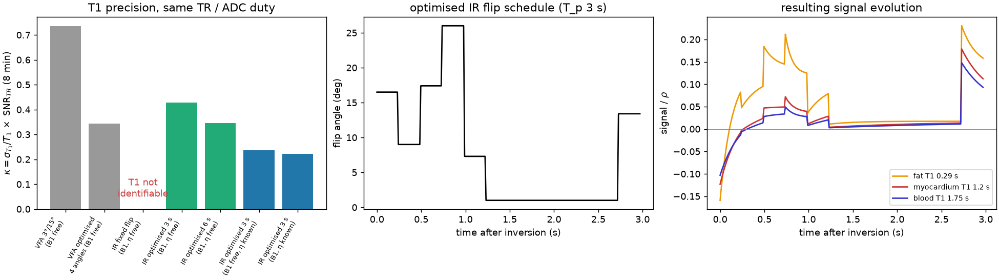

# T1, IVIM and DTI sequences next to the flow and B0 sequences (research note, 2026-11-27)

Question (user): add a very efficient T1 sequence, an IVIM sequence and possibly a DTI sequence (IVIM and DTI possibly
in one). The nonlinear model-based reconstruction should be exploited: modulate the signal in several ways at once
(flip angle, TR, inversion, ...) and acquire the maximum amount of data (yarnball-type readout).

Provenance. Literature below was collected by two web-search passes (abstract / snippet level for most papers, full text
for Han 2022 and Assländer 2019). Anything marked *(unverified)* was not confirmed. The CRLB study (§2.3) is ours
(`research/experiments/t1_crlb/`). Nothing here has been simulated through the full pipeline yet.

## 0. Short answer

1. **One framework for all three: the prepared train.** A *preparation* (inversion, saturation, diffusion-weighting, later
   T2-prep) followed by a *train* of N yarnball TRs (RF-spoiled, ADC on, flip-angle schedule), repeated. T1 = IR/SR
   preparations + a flip schedule. DWI = a spin-echo/STEAM diffusion preparation + the same train. The B0/ratemap
   sequence stays separate (short readouts) and is an *input* to both.
2. **T1: inversion alone is not enough once B1 and the inversion efficiency are unknown.** With a fixed flip angle, T1
   is structurally unidentifiable (exactly singular Fisher matrix, §2.3). A flip-angle schedule inside every
   inversion period removes the degeneracy; it is the *essential* modulation, not a refinement.
3. **Diffusion cannot use the RF-spoiled GRE steady state.** The efficient layout is a diffusion preparation followed by
   a *train of 50–150 yarnball TRs*. This also turns the shot-to-shot phase problem from one unknown per spoke into one
   low-order phase map per preparation (§3.2).
4. **Cost of the contrast modulation in the operator is the main engineering risk** (§2.5): the sample-wise amplitude
   factor adds a contrast rank $K$ on top of the field-segment rank $L$.

## 1. What exists today

- Flow sequence v2 (`data/hasty/seq/flow_thorax_v2`): RF-spoiled GRE, TR 14.1 ms, flip 15°, centre-out yarnball
  readout 9.5 ms, 7 encodes per rotation (coprime dual VENC), per-encode flow-compensated tail. ADC duty ≈ 0.67.
- B0/ratemap sequence (`hasty_seq::multiecho`): short out-and-back lobes, K = 24–32 echoes.
- `hasty-seq`: exact gradient moments M0/M1/M2 and the concomitant tensor $P=\int GG^\top$ (`wave`), GIRF chain with
  played history (`girf`, `tr::played_moments`), SAFE and GE PNS (`pns`, `pnsge`), Pulseq writer (`pulseq`), isochromat
  Bloch parcel simulator with RF spoiling (`bloch`), GIRF QA protocol.
- Missing for this note: **no EPG** (spoiling, diffusion, stimulated echoes), **no b-tensor** of a waveform, no
  preparation-pulse model, no T1 / diffusion truth in the phantom pipeline beyond PD/T1/T2*/ff jitter
  (`research/flow_phantom.md` §MR properties).

## 2. T1

### 2.1 Literature digest (found by search; abstract level unless noted)

| method | what it does | relevant result | for us |
|---|---|---|---|
| MPnRAGE (Kecskemeti 2016, MRM) | 3D radial, repeated IR, sliding-window; hundreds of IR-curve images in 7.5 min | $T_1$ = 1.00·FSE-IR + 24 ms, r² 0.99, brain only | closest in spirit (continuous IR + golden-angle radial); no thorax use found |
| MP2RAGE (Marques 2010) | two inversion times, ratio cancels PD, T2*, receive field, mostly B1 | residual B1 bias remains | brain; ratio trick is a special case of the joint fit |
| 3D-QALAS (Kvernby 2014 JCMR heart; Fujita 2019 brain) | interleaved Look-Locker + T2-prep | heart T1 1083±43 vs MOLLI 1089±54 ms (breath-hold) | T1+T2+PD in one scan; no B1 handling in SyMRI |
| Free-running 3D radial IR (Qi 2019 MRM; Phair 2023 MRM; Cruz 2020 NMR Biomed) | IR + continuous golden-angle radial SPGR, low-rank/subspace recon, motion correction | Qi: 1.5 mm, 9.5 min, precision 42±8 ms (MOLLI 41±7, SASHA 87±19). Phair: T1 reads ≈ 130 ms above MOLLI | **closest published relative of our setting**; none handles B1 |
| Han 2022 (MRM; arXiv 2111.07901, full text read) | ECG-gated adiabatic IR + SPGR stack-of-stars, dictionary with joint T1 + flip-angle fit, GE | joint fit removes the B1 bias but raises noise; unstable for the densest protocol; optimal flip plateau ≈ 9°; septal-lateral B1 spread 21–32 % | confirms our B1-coupling finding; assumes perfect inversion efficiency |
| MRF, CRLB-optimised schedules (Zhao 2019 TMI; Assländer 2019 hybrid state) | optimised FA/TR, hybrid state | optimised schedules are structured, not random; hybrid-state beats an optimised Look-Locker even for T1 alone | hybrid state needs balanced moments: conflicts with our spoiled, rotating spokes |
| Leitão 2020 (arXiv 2005.02876) | CRLB efficiency of transient sequences | transient sequences up to 3.5× more efficient than steady state, but the gain shrinks ≈ 5× once incoherent aliasing is counted as noise | our incoherence is the same problem: must be checked at our undersampling |
| DESPOT1-HIFI (Deoni 2007), Belsley 2023 (liver 3T) | VFA + IR for B1 | optimal angles straddle the Ernst angle; T1 CoV 6.2 % in liver | the VFA baseline |
| SASHA/MOLLI (Chow 2014, Kellman 2014) | heart T1 standards | SASHA bias small but 2–3-parameter fit costs 35–125 % precision vs MOLLI; MOLLI biased by MT, T2, HR | the clinical comparison values |
| MR-STAT, MRzero (Sbrizzi 2018, Loktyushin 2021) | fit Bloch model directly in k-space / differentiable sequence optimisation | MRzero optimises TI and recovery times with SAR + time in the loss | our recon is already this kind of model; the schedule optimiser should be too |
| Preibisch & Deichmann 2009 (MRM) | RF-spoiling bias in VFA T1 | the apparent T1 depends on the spoil increment (118.2°/121.8° exact-but-unstable, 50° stable but biased) | forces an **EPG forward model**, not the Ernst equation |
| Assländer arXiv 2409.05318 | MT explains up to 62 % of the white-matter T1 spread between methods | "T1" is method dependent | keep one pulse family; report $T_1^{app}$ unless MT is modelled |

Gaps found: no yarnball, cones or twisted-projection cardiac T1 mapping; no 3D free-breathing solution for blood T1
with inflow; no head-to-head CRLB number for IR vs VFA at equal ADC duty (hence §2.3).

### 2.2 What is special in our setting

- **Every TR is a usable measurement** (ADC duty 0.8+ without encode blocks) and every spoke visits $k=0$ at TE ≈ 0.3 ms,
  so the T1 curve is sampled at TR rate at low k, and the data energy sits there (99.9 % of the energy within the first
  0.4 ms, `readout_redesign.md` §2).
- **Free-running preparations**: IR/SR on a fixed clock, independent of ECG. Cardiac and respiratory state are handled
  by the frame operator, so heart-rate variation (MOLLI's problem) is not a bias source.
- **Inversion is non-selective and the excitation a 3D hard pulse**: all blood in the coil is inverted, so the inflow of
  non-inverted blood that breaks 2D Look-Locker is largely absent except from outside the transmit region. Blood T1
  (needed for the flow sequence's Bloch-parcel inflow model, `csf_inflow.md`, and its flip angle) is therefore in reach.
  *Residual risk:* spins entering from beyond the body-coil transmit volume.
- **Unknown count.** Per voxel: $\rho$ (complex, with coil phase), $T_1$, $B_1$ (smooth, spline basis like $B_0$), the
  inversion efficiency $\eta$ (smooth), plus the fat species. The ratemap (B0, R2*, fat fraction) is **known** from the
  B0 sequence. Fat has its own $T_1\approx0.29$ s: a global parameter, not a per-voxel unknown.
- **Data count.** One Nyquist set at 2 mm ≈ 3000–6000 spokes; 8 min at TR 11 ms ≈ 43 000 spokes ≈ 7–14 full sets, shared
  by ~180 contrast states per inversion period. Each contrast state sees only ~2–5 % of k-space, so a per-state image is
  hopeless; the parametric ($\rho,T_1,B_1$) or subspace model is mandatory (same conclusion as the B0 sequence,
  `b0_r2s_model_based.md` §1).

### 2.3 CRLB study of signal modulations (`research/experiments/t1_crlb/`)

Question. At identical TR (11 ms, readout 9.5 ms, no encode block = identical ADC duty) and 480 s, how precise is $T_1$
for different signal modulations when $\rho$, $B_1$ and the preparation efficiency $\eta$ are fitted as well?

Model. Ideal RF spoiling, TE decay absorbed in $\rho$, one noise-$\sigma$ measurement per TR (incoherent-sampling limit,
so only *relative* numbers carry over); $s_n=\rho\sin(B_1\alpha_n)M_z^{(n)}$, $M_z^+=M_z\cos(B_1\alpha_n)$, recovery
$M_z\to1+(M_z^+-1)e^{-TR/T_1}$; IR: $M_z\to-\eta M_z$ plus a 15 ms gap; SR: $M_z\to(1-\eta)M_z$. Periodic steady state
solved exactly. $\kappa=\sqrt{\mathrm{CRLB}(T_1)}/T_1$ at unit SNR per TR (real precision $=\kappa/\mathrm{SNR}_{TR}$),
geometric mean over fat 0.29 / liver 0.8 / myocardium 1.2 / blood 1.75 s at true $B_1\in\{1,0.7\}$.

| design (all $\rho,T_1$ free) | nuisances free | $\kappa$ |
|---|---|---|
| VFA 3° / 15°, steady state | $B_1$ | 0.74 |
| VFA, 4 optimised angle blocks (1°,1°,11.7°,30°) | $B_1$ | 0.34 |
| IR, fixed flip (any flip, any period 0.5–4 s; also SR) | $B_1,\eta$ | **∞ (Fisher matrix exactly singular)** |
| IR period 3 s, optimised 12-step flip schedule | $B_1,\eta$ | 0.43 |
| IR period 6 s, optimised 8-step schedule | $B_1,\eta$ | 0.35 |
| IR period 3 s, optimised | $B_1$ ($\eta$ known) | 0.24 |
| IR period 3 s, optimised | none ($B_1,\eta$ known) | 0.22 |
| saturation recovery period 3 s, optimised 8-step | $B_1,\eta$ | 0.50 |

Findings (each from the logs `run4.log`, `run5.log`):

1. **Fixed-flip inversion/saturation recovery cannot give $T_1$ when $B_1$ and $\eta$ are both unknown.** The curve has
   three observable numbers (amplitude, $T_1^*$, plateau) for four unknowns; the null direction contains $T_1$. With only
   $B_1$ free the fit is almost singular (κ ≈ 29), which is what Han et al. saw as "joint fitting raises noise".
2. **A flip-angle schedule inside the period is what makes $T_1$ identifiable.** The optimiser puts a high-flip burst
   directly after the inversion, a stretch of near-zero flip ("quiet recovery", at the 1° lower bound) and a final burst.
   The bursts determine $B_1$ through $T_1^*\propto 1/(B_1\alpha)^2$; the quiet stretch gives undisturbed recovery.
3. **Nuisance cost.** $B_1$ costs ≈ 10 % (0.22 → 0.24) once the schedule is optimised; a free, per-voxel $\eta$ costs ≈ 2×
   (→ 0.43), i.e. 4× scan time. An adiabatic inversion is flat in $B_1$ above threshold: treat $\eta$ as a smooth,
   low-order field or global parameter, not per voxel.
4. **Optimised VFA with $B_1$ free (0.34) beats IR with a per-voxel free $\eta$ (0.43) and is within 1.4× of IR with
   $\eta$ known (0.24).** IR does not dominate; both need the high-flip bursts. The decisive ingredient is the
   *transient after a perturbation* (inversion or a burst), not the inversion itself. A naive 2-angle VFA is 2× worse.
5. Longer inversion periods help when $\eta$ is free (6 s: 0.35 vs 2 s: 0.60); the optimum is not locked to the heart rate.
6. Mixing IR and SR periods (alternating 2–3 s IR + 1 s SR) did not help (0.47–0.49).

Caveats that must be tested before any decision:
- the optimum wants ≈ 40–60 % of the TRs at the flip lower bound. These TRs carry little information; this runs against
  "maximum data acquisition" and says the quiet stretch is a candidate for *another* use of the ADC (§2.6);
- the upper bound (30°) is active: SAR and the validity of ideal spoiling at high flip are unchecked;
- no MT, T2*, inflow, imperfect spoiling, diffusion in the spoiler; the incoherent-sampling limit overstates what
  undersampling allows (Leitão 2020: up to ≈ 5×);
- κ is relative. For orientation only: if the voxel SNR of a full Nyquist set at 1.5–2 mm is 30–100 and $N^*\approx 4000$–$7000$
  spokes, then $\mathrm{SNR}_{TR}\approx$ SNR$_{img}/\sqrt{N^*}\approx0.4$–$1.5$ and κ = 0.25–0.45 corresponds to
  $\sigma_{T_1}/T_1\approx$ 15–120 % **per voxel before any spatial prior**. The spatial prior and the smooth-$B_1$ model
  must carry the rest; a real SNR budget (`snrcheck`) is needed.

### 2.3b Head set, flip floor and "many modulation levels" (2026-11-27, `t1crlb_head.py`, `run6.log`)

User direction: T1 for its own sake, head, preference for many modulation levels over few high-SNR ones. Tissues: scalp fat
0.29, WM 0.83, GM 1.33, blood 1.75, CSF 4.2 s; true $B_1\in\{1,0.8\}$; $B_1$ and $\eta$ free (conservative).

| question | result (κ) |
|---|---|
| IR period 3 s → 6 s (K = 12, floor 1°) | 0.55 → 0.36: CSF (4.2 s) wants long periods |
| flip floor 1° / 3° / 5° / 8° at 3 s | 0.55 / 0.57 / 0.61 / 0.76 (+3 %, +11 %, +38 %) |
| flip floor 1° / 3° / 5° / 8° at 6 s | 0.36 / 0.39 / 0.44 / 0.60 (+6 %, +21 %, +65 %) |
| optimised VFA, 4 vs 12 angle blocks (floor 2°) | 0.42 vs 0.37 (+12 % from 3× more levels) |
| equally spaced VFA 2…30°, equal time, K = 3 / 6 / 12 / 24 | 0.61 / 1.10 / 1.36 / 1.40 |
| IR 4 s, optimised 24 pieces (floor 3°) | 0.42 |
| IR 4 s, fixed linear ramp / sine / random-smooth schedule | 1.40 / 1.23 / 0.89 |

Reading:
1. **More levels help only when the time allocation is optimised.** Equal-time many-angle VFA is 3.7× *worse* than the
   optimum (1.4 vs 0.37) because most of the time lands at flips that carry little T1/B1 information. The optimum always
   keeps two to three high-flip bursts (≈ 20–30°) and a long low-flip stretch; the levels in between add 10 %.
   "Modulate more" is therefore a statement about the *schedule family* (a smooth, many-parameter curve optimised by
   CRLB), not about spreading time uniformly.
2. **A flip floor is cheap up to 3° (+3–6 %), moderate at 5° (+11–21 %), expensive at 8° (+38–65 %).** A floor of
   3–5° makes every TR carry some signal and is the proposed compromise (decision 2 below).
3. **In the head IR no longer clearly beats VFA.** With free per-voxel $\eta$ the 6 s IR (0.36) equals the 12-block VFA
   (0.37). IR buys robustness for CSF-like long $T_1$ and costs SAR plus a free $\eta$; VFA bursts need no adiabatic
   pulse. Keep both as members of one schedule family (preparation optional).
4. What the CRLB cannot show: a more diverse schedule is more robust against model error (MT, imperfect spoiling,
   $B_1$ model shape). That is the real argument for many levels and it needs the bias study with the EPG model (WP2),
   not a variance number.

### 2.3c Second knob: TR; and inversion without a free efficiency (`t1crlb_tr.py`, `t1crlb_hard.py`, `run7`–`run9`)

Correction to 2.3b: its "equal-time many angles is bad" result is about spreading time evenly over one knob (flip angle).
It says nothing against modulating in several *ways*. Here TR is the second knob (head set, $B_1$ free, no preparation,
flip floor 3°, ceiling 30°, ideal spoiling). "idle": readout fixed 9.5 ms, longer TR = idle time. "duty": readout grows with
TR (constant ADC duty; optimistic for TR > 25 ms because of T2*, off-resonance, flow). TR capped at 25 ms.

| design (equal total time) | κ idle | κ duty |
|---|---|---|
| 2 flips, TR 11 ms | 1.01 | 1.01 |
| 4 flips, TR 11 ms | 0.48 | 0.48 |
| 1 flip, 3 TRs | 2.04 | 1.56 |
| **2 flips × 2 TRs** (11, 25 ms) | **0.50** | **0.42** |
| **2 flips × 3 TRs** | **0.41** | **0.35** |
| 6 free (flip, TR) blocks | 0.38 | 0.29 |

(With TR up to 80 ms: 2 × 2 → 0.46 / 0.30, 6 free blocks → 0.38 / 0.20; the optimum sits on every bound, so the real limit is
the readout/TR the physics allows.)

1. Two flips alone cannot separate $T_1$ from $B_1$ (κ 1.0). Adding a second TR to the same two flips gives what four flips
   give (0.50 vs 0.48); three TRs beat four flips. TR enters through $\exp(-TR/T_1)$, flip through $\cos(B_1\alpha)$:
   different dependence on $T_1$ and $B_1$, hence a different direction in parameter space. One flip with several TRs is
   useless (it cannot see $B_1$): both knobs are needed.
2. In the "duty" mode longer TR with a longer readout is cheap in information, so a TR-modulated schedule can keep ADC duty
   ≈ 0.8 across the train. Longer yarn readouts (to 20–25 ms) cost model error (R2*, field, flow in the readout) and are not
   free; a bias study decides.
3. **Inversion options** (period 6 s, 8-piece flip schedule, floor 3°): adiabatic with $\eta$ known 0.25; adiabatic with a
   free per-voxel $\eta$ 0.40; **hard 180° pulse with $\eta=-\cos(\pi B_1)$ tied to $B_1$ (and in practice to the known ratemap
   off-resonance): 0.32**, with no extra unknown and extra $B_1$ information. So an inversion with a known-shape response
   costs less than an adiabatic one with a free efficiency, and no adiabatic pulse is required.
4. **With the user's limits (TR ≤ 20–25 ms, readout ≤ 15 ms; measurement weight = ADC time, readout = min(15 ms, TR − 1.5 ms),
   `run10_cap15.log`):** 2 flips × 2 TRs 0.47 (TR 20) / 0.45 (TR 25); 2 flips × 3 TRs 0.39 / 0.37; 6 free (flip, TR) blocks
   0.32; 4 flips at TR 11 ms 0.48. TR 20 ms is almost as good as 25 ms (ADC duty 0.75 at 15 ms/20 ms). So the
   realistic gain of the TR knob is ≈ 20 % (2×3) to 33 % (free blocks) in κ, i.e. 1.5–2.2× scan time, smaller than the
   "duty" table because the readout is capped.
5. Not modelled here and decisive for the final choice: imperfect spoiling (needs $T_2$ and the RF-spoil increment in the
   signal model), flip-angle nonlinearity of the RF amplifier, MT. Increment modulation (e.g. alternate 117° and another
   value) is a third knob that makes the spoiling bias observable; it needs the EPG model (WP1).

### 2.3d EPG bias and information with T2 and the RF-spoil increment (2026-11-27, `hasty_seq::epg`, `t1bias`, `run11`–`run13`)

Tools: `rustlib/crates/hasty-seq/src/epg.rs` (EPG with RF, T1/T2, gradient shift, crusher, inversion/saturation with
efficiency, diffusion damping, quadratic RF-spoil phases, cyclic steady state; 8 unit tests: unitarity, 90°/180°, crushed
train = Ernst to 1e-10, inversion closed form, diffusion closed form, `kmax` doubling), driver `src/bin/t1bias.rs`
(cyclic flip × TR blocks, 5 tissues T1/T2 = fat 0.29/0.07, WM 0.83/0.07, GM 1.33/0.095, blood 1.75/0.15, CSF 4.2/1.5 s,
B1 1.0 and 0.8, TE 2 ms, 1 gradient unit per TR, `kmax` 150, 14 cycles), `t1bias.py` (fit of the *ideal-spoiling* model to
EPG data), `t1bias_sum.py` (Fisher κ). Built and tested in a separate target dir (`rustlib/target/epg-check`, gitignored) so other agents' builds are not blocked.

1. **Bias of the ideal (Ernst-recursion) model fitted to EPG data.** *Correction, same day:* my first version of this item
   claimed tens to hundreds of % and "the ideal model cannot be used"; that was too strong, it came from the schedule,
   not from ideal-vs-EPG as such. Checks (`run14`–`run19`):
   - Single-flip steady states (`ratio_check.py`, `run14_ratio_check.log`): EPG/Ernst signal within 0–3 % at 117° and 150°
     (WM, GM), up to 5–8 % for blood at 15–20° / TR 11 ms (blood T2 0.15 s). Classic 2-angle VFA (3/15°, 6/20°, 3/30°, B1
     known, 8 s blocks): T1 error 0–5 % (WM), 1–11 % (GM), 1–20 % (blood) at TR 11 ms, about half at TR 20 ms. Agrees with
     the VFA literature (a few to ~20 % without spoiling correction); the EPG code is not the problem (a first version of the
     check script had TR in ms in the Ernst formula, fixed).
   - Same flips, only the block length changed (`run19_block_length.log`, B1 known, 117°): 3°/15° with **8 s** blocks: WM 3 %,
     GM 7 %, blood 12 %; with **1 s** blocks: WM 13 %, GM 69 %, blood > 3000 %. 3°/30°: 8 s blocks −2 / 0 / 0 %, 1 s
     blocks −10 / −9 / −1 % (and 150°: +5 / +2 / −11 vs +18 / +13 / −29 %).
   - The extreme CRLB schedule (3°/30° × TR 11/20 ms, 1 s blocks; `run11`, `run15`–`run17`) gives +0…+120 % (GM), > 500 % in
     blood at 117° even with B1 known, 150° is better (WM 3–16 %, GM −8…+23 %, blood −3…−30 %).
   - Reading: the CRLB optimum picks short alternating blocks in which the T1 sensitivity of the signal is a small fraction
     of the signal change, so a 3–5 % unmodelled spoiling error (fit residual 1–5 % of peak vs 0.2–1 % for 8 s blocks)
     becomes a large T1 error. Mechanism not isolated: dropping the first 10–25 pulses of every block from the fit reduced
     the residual but not the bias (`run18_skip_test.log`), so transients after flip changes are not the whole story.
   - So: **long-block VFA is fine with the ideal model to the usual literature accuracy; CRLB-optimal short-block
     schedules are not robust to it.** Robustness to model error has to be a design criterion next to κ, and the EPG model
     (with T2) should be in the recon either way, since it removes the known part of the error.
2. **Information with the EPG model** (Fisher, relative parameters, geometric mean over WM, GM, blood, CSF and B1 1/0.8;
   same 2×2 schedule, `run13_fisher_summary.log`): Ernst 3 free (ρ, T1, B1) κ 1.86 (CSF 8.8); EPG with T2 *known*
   1.18 (117°) / 1.47 (150°) / 1.34 (alternating); EPG with T2 *free* (4 parameters) 1.35 / 1.57 / 1.45. Freeing T2 costs
   only 5–15 % in κ; the partly unspoiled signal carries T1 information, so the EPG fit is not worse than the ideal one
   (WM 0.57 vs 0.61, CSF 3.0 vs 8.8). The milder schedule 6°/24° is 5–25 % worse than 3°/30° for all of these; the 6-block
   schedule 3/30/3/12/30/3° × (20, 20, 11, 11, 16, 20 ms) gives κ 0.81 (117°, T2 known) / 0.88 (T2 free) / 1.0 (150°).
3. Consequences: (a) T2 is a per-voxel nuisance parameter (or a smooth map) of the same fit, cost ≈ 10 %; (b) RF-spoil
   increment is a **design parameter**: 117° maximises information (largest EPG deviation) but needs the model to be exact;
   150° is nearly ideal (small bias) at ≈ 25 % higher κ; alternating increments give the model-error observability the user
   asked for at intermediate κ; (c) the final choice needs the unmodelled-error test (mismatch between the generating EPG
   and the fitted EPG: gradient-moment variation of rotated spokes, MT, B0 dephasing).
4. Limits of this study: one gradient unit per TR and a fixed moment (rotated yarnball spokes vary — checked separately
   with `spoil.rs`); no MT; tissue T2 values assumed; the schedule is one hand-picked family, not re-optimised under the
   EPG model; the bias numbers apply to short (1 s) blocks and shrink with long blocks (item 1). Next: add a bias term
   (EPG vs ideal mismatch projected on the Fisher direction) to the schedule optimisation and look at block length
   (and gradual flip changes) as a design parameter.

### 2.3e Intrathecal gadolinium: precision over T1 = 0.1–4.5 s (2026-11-27, `t1crlb_wide.py`, `run20`–`run23`)

New requirement (user): main use is **intrathecal gadolinium** (CSF T1 ≈ 4.2–4.3 s baseline, concentration build-up in CSF and
tissue), so T1 must be accurate over the **whole 0–4500 ms range**, CSF first. Consequences for the metric: concentration is
$C=\Delta R_1/r_1$, so the figure of merit is the **absolute** precision $\sigma_{R_1}=\kappa_{T_1}/T_1$ (1/s), not the relative
T1 precision of §2.3–2.3d (which weighted tissues by relative error). Tolerance used (my assumption, to be confirmed):
$0.02\,\mathrm{s^{-1}} + 5\,\%$ of $R_1$; objective = L4 norm over the T1 grid {0.1, 0.2, 0.4, 0.7, 1.0, 1.5, 2.2, 3.0, 3.8, 4.3} s
and $B_1\in\{1,0.8\}$ of $\sigma_{R_1}/\mathrm{tol}$. Ideal spoiling, ρ, T1, B1 free, TR ≤ 25 ms, readout ≤ 15 ms, flip 3–30°, hard-180
inversion with $\eta=-\cos\pi B_1$ (no extra unknown). Per unit SNR per TR (real precision = value / SNR_TR).

| design | L4 | σ_R1 at T1 = 4.3 s (1/s) | at 1.0 s | at 0.1 s |
|---|---|---|---|---|
| classic VFA 3°/15°, 8 s blocks | 38.1 | 0.23 | 0.53 | 30.8 |
| earlier head-optimised 6 blocks (1 s) | 7.6 | 0.32 | 0.25 | 4.9 |
| no-prep K=4 × 1 s | 10.7 | 0.51 | 0.30 | 4.4 |
| no-prep K=4 × 2 s | 7.0 | 0.27 | 0.28 | 4.9 |
| no-prep K=6 × 2 s | 6.6 | 0.24 | 0.30 | 4.7 |
| no-prep K=6 × 4 s | 7.7 | 0.22 | 0.33 | 6.1 |
| **hard IR, T_p 6 s, 8 pieces, TR 20 ms** | 5.1 | 0.22 | 0.21 | 2.3 |
| **hard IR, T_p 9 s** | 4.5 | 0.17 | 0.23 | 2.4 |
| **hard IR, T_p 12 s** | 4.5 | 0.165 | 0.24 | 2.6 |

1. A single wide-range requirement favours **inversion**: best no-prep 6.6 vs best IR 4.5 (≈ 30 % lower), and the CSF end is
   ≈ 30 % better with IR (0.17 vs 0.24 /s). T_p ≥ 9 s needed (CSF recovers over several seconds); 9 s vs 12 s is a tie.
   The optimum shape is again bang-bang: bursts of 8–22° right after the inversion (they sample the short and mid T1
   recovery), then a 3° floor for the remaining ~⅔ of the period (the CSF recovery).
2. **The two ends of the range limit the design.** CSF end: σ_R1 ≈ 0.17 /s per unit SNR_TR against a tolerance of 0.032 /s
   needs SNR_TR ≈ 5; short end (T1 0.1 s, 1 mM-level CSF Gd near the injection site): 2.3–2.6 /s against a tolerance of 0.52 /s
   also needs ≈ 5. A higher flip ceiling does not help (45°: 4.54, 60°: 4.91, optimiser noise) — the short end is limited by
   having only ≈ 5 TRs of 20 ms inside the 100 ms recovery; a shorter-TR segment right after the inversion is the lever (not yet
   optimised; TR was fixed at 20 ms in the IR family).
3. SNR_TR is not known here: calibrate against `snrcheck` before deciding whether ≈ 5 is realistic.
4. Not covered yet and **specific to this use**: (a) CSF has T2 ≈ 1.5–2 s ≫ TR, the worst case for RF-spoiling bias
   (§2.3d: CSF T1 errors of −20…−90 % with the ideal model in the extreme schedule, κ 2.4–3.6 with EPG); with Gd, T2 falls
   too ($1/T_2=1/T_{2,0}+r_2C$, $r_2\approx r_1$–$1.3\,r_1$), so T2 varies with concentration; the EPG with T2 free is
   required and the IR designs must be rerun through it; (b) CSF pulsation / flow and inflow (spin history through the inversion
   slab), partial volume in sulci, dura/vessels with fast flow; (c) concentration needs a baseline (pre-injection T1 map) per
   voxel; its error adds. (d) 5 %-or-0.02 /s tolerances are my guess.

### 2.3f EPG check of the inversion designs with a gadolinium model (`bin/t1ir.rs`, `t1ir.py`, `run24`–`run28`)

Cases: T1 grid 0.1–4.3 s along three uptake series with $C=(1/T_1-1/T_{1,0})/r_1$, $1/T_2=1/T_{2,0}+r_2C$, **assumed** $r_1=4$,
$r_2=5$ mM⁻¹s⁻¹ (placeholders until the literature note arrives): CSF ($T_{1,0}$ 4.3 s, $T_{2,0}$ 1.6 s), grey matter (1.33 s, 95 ms),
white matter (0.83 s, 70 ms). Design: hard-180° (π·B1) + crusher + 15 ms gap, then 8 flip pieces at TR 20 ms, period $T_p$. EPG data
are the **signed** (phase-sensitive) echo; B1 1.0 and 0.8. (First version used |signal| after the inversion and gave absurd biases —
fixed; the sign check is `dbg_ir.py`.) Fisher: σ_R1 for the ideal model (ρ,T1,B1), EPG with T2 known and EPG with T2 free; bias:
ideal-model fit to EPG data (B1 free, truth start) in units of the tolerance 0.02 + 5 % R1.

1. **Information is not hurt by T2.** IR $T_p$ 9 s: σ_R1 (ideal / EPG T2 known / EPG T2 free) at CSF 4.3 s 0.174 / 0.143 / 0.162,
   at 1 s 0.229 / 0.225 / 0.229, at 0.1 s 2.50 / 2.48 / 2.51 (1/s per unit SNR_TR). Freeing T2 costs ≤ 13 % at CSF, nothing
   elsewhere. $T_p$ 12 s: 0.166 / 0.157 / 0.161 at CSF.
2. **Tissue uptake: ideal model is enough.** GM and WM series, 117° and 150°: R1 bias ≤ 0.044 /s at T1 0.1 s and ≤ 0.012 /s for
   T1 ≥ 0.2 s, i.e. ≤ 0.2 tolerance units. Short T2 makes spoiling effective; the transient after the inversion is modelled exactly.
3. **CSF is the only place where model error matters** (T2 1.6 s ≫ TR 20 ms; EPG signal differs from ideal by up to 15–30 % of the
   peak). Ideal-model R1 bias, $T_p$ 9 s design, vs RF-spoil increment (1/s; tolerance at 4.3 s is 0.032):

   | increment | 84° | 100° | 117° | 137.5° | 150° | 169° |
   |---|---|---|---|---|---|---|
   | bias at T1 4.3 s | −0.10 | −0.23 | **+0.04** | +0.07 | −0.23 | +0.05 |
   | bias at T1 2.2 s | +0.04 | −0.10 | +0.04 | +0.04 | −0.14 | +0.03 |

   So ≈ 1–2 tolerance units for the good increments (117°, 137.5°, 169°), up to 7 for 100° and 150°. The best increment for CSF (117°)
   is not the best for tissue-like T2 (150°, §2.3d) — only matters if the ideal model is fitted; with the EPG model (T2 free) the
   bias is the *model error* of the EPG itself, which this study cannot show (inverse crime).
4. Stronger gradient spoiling (1, 2, 3, 4 dephasing units per TR) changes the CSF bias by < 0.04 /s: the residual comes from the
   RF-spoil pattern, not from the spoiler moment; so a bigger spoiler is no remedy.
5. **Design consequences so far:** (a) inversion + 8-piece schedule with $T_p$ 9–12 s covers 0.1–4.3 s with σ_R1/tol ≈ 3–5 per unit
   SNR_TR (§2.3e); (b) the fit model must be the EPG (T2 free per voxel, or a T2(C) relation); (c) increment 117° (or 137.5°/169°)
   rather than 150°; (d) the short-T1 end (T1 100–200 ms: 2.5 and 1.0 /s) is the weak point and needs a short-TR block right after
   the inversion; (e) remaining unknowns: CSF motion, inflow, true EPG model error (needs isochromat simulation with real
   gradient moments: `spoil.rs`/`bloch.rs`), literature values of r1, r2, T2.

### 2.3g Realistic range from the literature (`lit_intrathecal_gd_t1.md`) and re-optimised designs (`run29`, `run30`)

Literature agent (abstract/full-text tags in the file; r2 and the injection-site concentration are not published): after 0.5 mmol
intrathecal gadobutrol the CSF peaks at ≈ 0.5 mM (T1 ≈ 390–600 ms), cortex ≈ 0.1 mM, blood µM; **T1 ≈ 100 ms (≈ 3 mM) occurs
only near the injection site**; CSF baseline T1 4.2–4.5 s, T2 ≈ 1.9–2.4 s; r1 in CSF at 3T 3.0–3.6 (scanner dependent, up to 18 %,
**must be calibrated on our scanner/sequence**); tissue baseline T1 1.0–1.5 s. Published mapping: Look-Locker (T1 < 1.5 s) +
IR spin echo (CSF), VFA SPGR (needs B1 correction: 25 % vs 6 % error in rat), MP2RAGE underestimates CSF T1 by 46 %, MRF needs
dictionary > 4.5 s. No paper states a formal precision target (nearest: ±3 % T1 margin, Look-Locker ≈ 5 %). 0.01 mM changes CSF R1
by 13 % and tissue R1 by 4 %.
So the design grid is now **T1 = 0.3–4.5 s** (the 100–200 ms end is dropped), my assumption r1 = 4, T2,0 = 1.6 s in §2.3f was
slightly off (3.0–3.6; 2 s) but does not change the picture. Optimised on the narrow grid (L4 of σ_R1/tol, tol = 0.02 + 5 % R1 ≈ 0.01 mM;
σ_R1 per unit SNR_TR):

| design | L4 | σ_R1 at 4.5 s | at 1.0 s | at 0.3 s |
|---|---|---|---|---|
| earlier head-optimised 6 blocks | 6.8 | 0.32 | 0.25 | 0.85 |
| no-prep K=4 × 2 s | 5.5 | 0.245 | 0.256 | 0.96 |
| no-prep K=6 × 2 s (12 s cycle) | 4.8 | 0.172 | 0.273 | 1.12 |
| hard IR $T_p$ 6 s, 8 pieces | 5.0 | 0.230 | 0.217 | 0.57 |
| hard IR $T_p$ 9 s | 4.1 | 0.166 | 0.219 | 0.70 |
| **hard IR $T_p$ 12 s** | **4.0** | 0.155 | 0.220 | 0.76 |
| hard IR $T_p$ 12 s, free TR per piece | 3.95 | 0.151 | 0.217 | 0.75 |

1. Inversion is still best but the margin shrinks to ≈ 15–20 % overall (CSF end 5–10 %, short-T1 end 30–40 %); the best no-prep
   schedule (6 blocks × 2 s: 30° burst, 20°/10° blocks, then 3° floor) is a serious fallback that needs no inversion pulse.
2. A free TR per piece gives nothing (≤ 2 %): TR goes to 25 ms (ADC duty) except 16–22 ms in the burst pieces. So **TR 25 ms
   with a readout of 15 ms is fine** for the T1 sequence; the flip schedule is the lever.
3. Required SNR per TR for σ_R1 = tolerance: ≈ 5 at CSF (tolerance 0.032 /s) and 3.7–4 at 0.3–0.4 s. **My tolerance (0.02 /s + 5 %
   of R1) resolves ≈ 0.01 mM; a "5 % of T1" requirement at CSF (0.011 /s) needs SNR_TR ≈ 15**, three times more — the
   tolerance decides the feasibility.
4. Open before building: increment (117° from §2.3f), EPG model error in CSF, flow, B1 calibration of r1, and the SNR_TR actually
   available (`snrcheck`).

### 2.3h Reference protocol: Wåhlin et al., PNAS 2026 (user pointer 2026-11-28)

"Quantitative assessment of flow between cerebrospinal and interstitial fluid compartments in humans" (PNAS 123(18) e2526239123, PMC13142984,
code/data github.com/anderswahlin/CSF-TISSUE-EXCHANGE). Intrathecal gadobutrol 0.25 mL × 1 mmol/mL = 0.25 mmol; scans baseline (day before) and ≈ 3, 5, 7, 22 h;
14 subjects, GE Signa PET/MR (13) + Signa Premier (1) at 3 T. **T1 map: 3D FSPGR VFA, only 2° and 12°, TR 7.2 ms, TE 2.9 ms, 1 mm isotropic, 12.5 min, B1 by
Bloch–Siegert (20°, 4 mm in-plane)**, flip angles chosen for T1 0.4–4 s; $C=(1/T_{1t}-1/T_{1,0})/r_1$ with $r_1$ = 3.4 (Gadovist) / 2.9 (Dotarem) mM⁻¹s⁻¹ (external calibration),
$T_{1,0}$ from the pre-injection scan. CSF ROIs: baseline T1 > 4 s, ≥ 10 voxels, discard negative mean C; tissue ROIs baseline T1 < 2.5 s. No phantom/accuracy validation, no numeric
concentration or T1 values in the text (figures only), 36 % of dose (0.09 mmol) left in the craniospinal system at 22 h. Limits they state: noise → slightly negative C,
registration of post-contrast FA images fails as contrast changes, low tissue Gd forces fixed parameters in the flow model.

**Measured concentrations (their `dataset1.mat`, 14 subjects, ROI means at 3.1 / 5.1 / 7.1 / 22.3 h; `wahlin_inspect.py`, `wahlin_ranges.py`, data kept untracked in
`experiments/t1_crlb/external_wahlin/`; unit assumed mM, consistent with CSF peak ≈ 0.4–0.5 mM in §2.3g; the user is unsure whether the files are the final curves or
a method demonstration):**

| ROI class | C percentiles 10 / 50 / 90 / max (mM), 3–7 h | T1 (assumed baseline, r1 3.4) |
|---|---|---|
| CSF next to cortex | 0.006–0.01 / 0.02–0.07 / 0.14–0.28 / 0.38–0.43 | 4.3 s → 0.59 s at the max |
| cortex | −0.006…−0.003 / 0.004–0.011 / 0.017–0.042 / 0.06–0.10 | 1.5 s → 1.0 s |
| white matter | −0.010…−0.008 / 0.003–0.006 / 0.017–0.022 / 0.04–0.07 | 0.85 s → 0.70 s |
| subcortical | −0.007…−0.004 / 0.002–0.010 / 0.016–0.024 / 0.03–0.06 | 1.1 s → 0.9 s |

At 22 h CSF median 0.12, tissue median 0.02–0.026 mM. Consequences: (1) CSF T1 stays ≥ ≈ 0.6 s, the 0.1–0.3 s end is not needed; (2) **tissue signal is tiny**
(median 0.004–0.02 mM = ΔR1 0.015–0.07 s⁻¹ on R1 0.7–1.2 s⁻¹), and their ROI-mean tissue curves already scatter to −0.015…−0.023 mM at the 1st percentile, so their noise is ≈ 0.01 mM
= σ_R1 ≈ 0.035 s⁻¹ *after ROI averaging*. My tolerance 0.02 s⁻¹ + 5 % R1 (≈ 0.07 s⁻¹ at tissue R1 ≈ 1) is **too loose for tissue**: tissue wants σ_R1 ≲ 0.01–0.02 s⁻¹ absolute at T1 0.7–1.6 s,
CSF only ≈ 3–5 % relative. Tolerance must be redefined (user decision).

**Design comparison, B1 not pessimistic (`t1crlb_vs_lit.py`, `run37.log`; ideal spoiling, unit SNR_TR, narrow grid):** Fisher with a Gaussian prior on B1 (their B1 map)
instead of free. (Retracts the "5–10× worse" of the first version of this section: it came from fitting B1 freely for their 2-flip design, which cannot determine it.)

| σ_R1 (s⁻¹) at T1 = | 0.3 | 0.6 | 1.0 | 2.0 | 4.5 | L4(σ/tol) |
|---|---|---|---|---|---|---|
| literature 2/12°, B1 free | 5.4 | 1.65 | 0.79 | 0.35 | 0.19 | 19.2 |
| literature 2/12°, B1 prior 3 % | 1.48 | 0.57 | 0.33 | 0.20 | 0.155 | 5.95 |
| ours IR (13.1/11.6/3/30/3/3/3/3°, TR 20), B1 free | 0.76 | 0.34 | 0.22 | 0.15 | 0.155 | 4.03 |
| ours IR, B1 prior 3 % | 0.59 | 0.30 | 0.20 | 0.13 | 0.134 | 3.33 |

B1 known to 1–5 % makes no difference in Fisher (prior 5 % ≈ 1 % ≈ known). With B1 known their design is **≈ 1.2× worse in CSF (4.5 s), 1.7× at T1 1 s, 2.5× at 0.3 s**
(L4 5.95 vs 3.33, ≈ 1.8×), i.e. a decent design: the gain of our IR train is real but moderate, not an order of magnitude. Systematic B1 error (fit with B1 fixed 5 % off): their design
R1 bias 0.5–1.7 tol units (largest at short T1, 1.34 at T1 1 s ≈ 0.09 s⁻¹), ours 0.9–1.3 if B1 were fixed too, so B1 error must be handled by fitting B1 (prior) in our model.
Caveats: SNR_TR differs (Cartesian 1 mm vs undersampled yarnball, not computed); duty weight of the Cartesian readout 0.6 assumed; EPG/T2 errors not applied to their design.

### 2.3i B1 sensitivity (user 2026-11-28: "we should have a sequence where B1 is estimated well"; `b1prec.py`, `run38.log`)

How B1 maps are made: **double angle** (images at α and 2α, ratio = 2cos α; needs TR ≥ 5 T1, hopeless for CSF), **AFI** (two interleaved TRs, TR2 = n·TR1, ratio
$(1+n\cos\alpha)/(n+\cos\alpha)$, T1-insensitive when TR ≪ T1, needs very good spoiling — CSF's long T2 is the bad case), **Bloch–Siegert** (off-resonance pulse after excitation
adds phase ∝ B1², SAR-heavy; this is what Wåhlin et al. used on GE), **DREAM/SA2RAGE** (stimulated-echo/saturation ratios, mostly Siemens), and **T1 sequences that are B1-sensitive
by design** (flip-angle spread, inversion with efficiency cos πB1).
Ours already is the last kind: σ(ln B1) per unit SNR_TR with B1 free = 0.11–0.18 for the IR design over T1 0.3–4.5 s vs 0.30–0.86 for the 2/12° VFA (3–5× better, because the
inversion cos πB1 and the 3°…30° spread constrain B1). At SNR_TR ≈ 5 that is 2–4 % voxelwise, and B1 is smooth, so a low-order B1 model over the head (fit jointly in the same recon) averages
this well below 1 %. B1 is also unchanged between the baseline and the Gd scans (same coil loading), so one B1 map can be shared across the whole series.
Risk: with B1 free, B1 absorbs any EPG/spoiling/inversion model error (confounding); an independent short B1 scan (Bloch–Siegert or AFI-like TR pair) used as a prior is a cross-check, not a necessity.

### 2.3j Bloch–Siegert B1 prior block (user 2026-11-28: add BS as prior; short, yarnball, CS) — design reasoning, nothing simulated yet

- **Physics (derived, to verify with bloch.rs):** an off-resonance pulse (offset Δ ≫ γB1) after excitation shifts the resonance by $\gamma^2B_1^2/(2\Delta)$, giving the extra phase
  $\varphi_{BS}=\int\gamma^2B_1(t)^2/(2\Delta(t))\,dt$ ∝ B1². Acquire with +Δ and −Δ; $\varphi_{BS}=(\varphi_+-\varphi_-)/2$ cancels coil/receive phase, B0 phase and most drift; the sum gives the B0 phase (known from the B0/T2/fat map, so only a
  consistency check). Residual: φ depends on (Δ+ω_off) → correct with the B0 map (ω_off/Δ ≈ 100 Hz/4 kHz = 2.5 % of φ, i.e. 5 % of B1 uncorrected, hence the correction is needed).
- **Precision:** $\sigma(\ln B_1)=\sigma_\varphi/(2\varphi_{BS})$. Design φ_BS ≈ 1–1.5 rad at nominal B1 (below π, no wrapping even at B1 0.7–1.2): voxel SNR 10 → σ_ln B1 ≈ 3–5 %, before smoothing. For φ=1.5 rad, Δ/2π = 4 kHz, T_eff = 4 ms this needs rms B1 ≈ 16 µT (derived) — SAR sets TR.
- **Extra information:** none about T1. The magnitude is a spoiled GRE at the excitation flip (e.g. 15–20°, TR 25–40 ms), a free PD/T1-weighted extra datapoint and coil sensitivity info, usable as extra "knot" in the joint recon; the BS pulse adds slight off-resonance MT saturation (systematic, bounded by large Δ).
- **TR:** phase is insensitive to T1 to first order (any steady state works), so a **short TR is fine and preferred (25–40 ms)**; the lower limit is SAR of the BS pulse (≈ 4–8 ms at high B1), not T1. No inversion, runs outside the IR cycle (separate block, no cyclic steady state needed).
- **Time (my earlier "a few minutes" was an unsupported guess; corrected):** B1 is smooth, so the block needs only low resolution, ≈ 6 mm (their own B1 map: 4 mm in-plane, 5 mm slices). Nyquist at 6 mm, FOV 220×220×180 mm ≈ 37×37×30 ≈ 20–40 k k-space samples; one 15 ms yarnball readout carries thousands, so ≈ 10–60 shots per offset; ×2 offsets × 25–40 ms ≈ 1–5 s per complete average.
  Voxel volume 216× that of 1 mm → SNR per voxel ≈ 15× per unit. Expected **≈ 5–20 s total** incl. a few averages; compressed sensing/coil sensitivities can cut it further but at this size the block is dominated by dummy scans and SAR, not sampling (verify with `snrcheck`).
- **Recon:** the cleanest is not an image map at all: fit a low-order B1 model (≈ 3rd-order polynomial or 5×5×5 cosines, 50–120 coefficients, complex-free real) directly to the ± difference phases in k-space, then feed it as the **B1 prior** (σ 2–3 %) into the T1 recon, shared across the baseline and the Gd scans.
- Open: BS pulse support/SAR in pge2/Pulseq on the Signa Premier; offset sign handling per TR (alternate ± every TR to cancel drift); motion between the B1 block and the T1 train.

### 2.3k Patients with implants (shunt valves) — corrects the smooth/low-order B1 assumption of §2.3i/j (user 2026-11-28)

Intrathecal Gd patients are often shunted (hydrocephalus/iNPH). Programmable valves (titanium or stainless parts, internal magnets; scalp/retroauricular, ≈ 3–6 cm from cortex) disturb B0 and RF locally.
Literature (3T, in vitro/in vivo; Shellock/Codman Hakim AJNR 2006; proGAV, Certas, Sophy, Medos papers): signal voids larger than the valve, GRE worse than spin echo, in vivo field distortion/artifact
**4×4×4 cm (Medos) to 6×6×12 cm (Sophy)**, ≈ 1 cm beyond the valve for a gravitational valve, setting-dependent (magnet orientation), 316L steel worse than titanium; function unchanged at 3T
but valve setting must be checked after the exam; two programmable VP valves labelled unsafe at 7T. **B1 distortion of shunt valves is not quantified** in what I found (only a cardiac-implant 3T study: B1 changes small, mostly at the periphery).
Consequences for the design:
1. **B0 is the harder problem and it is not low order near the valve:** dipole field ∝ 1/r³, kHz-scale within a few cm. Voxels inside the void give no signal (no T1 either way); the transition zone has blurred, mis-registered, flip-angle-wrong signal.
   The ≤ 15 ms readout, the field-segment correction and a non-selective hard pulse (flip/phase error when |off-resonance| ≳ γB1/2π) all degrade there. The B0/T2/fat map is least accurate exactly here (§ scope of readout limit).
2. **B1 prior must not be a global smooth model.** Use a **smooth field × robust local deviations** (e.g. B-spline on 15–20 mm knots + sparse/TV deviation term, Huber/Student-t loss), with a **per-voxel trust weight** from the B0 map (|ω_off|, |∇B0|, ratemap, signal level, residual of the smooth fit). Where trust is low the prior weight → 0 and the T1 train alone determines B1 (σ ln B1 0.11–0.18 per unit SNR_TR, §2.3i), which is the reason to keep it B1-sensitive by itself.
3. **Bloch–Siegert is biased by off-resonance:** φ_BS ∝ 1/(Δ+ω_off); with ω_off of kHz near the valve and Δ = 4 kHz the B0 correction fails. Use a larger |Δ| (6–8 kHz, SAR cost) and mask where |ω_off| > ~Δ/10; do not trust BS phase in the transition zone. The ± pair cancels only the part symmetric in Δ.
4. **Resolution cost:** time for fixed per-voxel SNR ∝ (resolution)⁻⁶ (samples ∝ res⁻³, SNR per voxel ∝ res³): 6 → 3 mm costs ≈ 64× (derived scaling; ≈ 5–20 s → minutes). So BS stays coarse (≈ 6 mm) away from implants and fine structure near them must come from the T1 train or a local, sparsity-regularised refinement; do not scale BS to implant-resolution everywhere.
5. **Safety constraints:** MR-conditional shunts carry labels (B1+rms/SAR, field, normal operating mode, setting re-check). Our design has hard 180° inversion, 30° bursts at TR 20 ms and BS pulses; compute **B1+rms and head SAR per block** and keep within the label of the actual shunt models. Needs the list of shunt models/labels from the user (clinical partner).
6. Artifact masks (void + transition) must be propagated: T1/concentration not reported there, excluded from the B1 fit, from the coil/ratemap estimation and from the convergence criteria; CSF flow along the catheter is out of scope.
7. Test plan: simulate a valve as a susceptibility dipole (+ optional conductive B1 perturbation) in the phantom, check R1/B1 error vs distance and that the robust B1 prior does not leak void bias into neighbouring tissue.

### 2.4 Candidate designs

| id | design | knobs | estimated | main risk |
|---|---|---|---|---|
| **T-A** | non-selective adiabatic IR every 3–6 s, flip schedule per period with bursts and quiet recovery, golden-angle yarnball | period, schedule (optimised by CRLB/MRzero-style), IR pulse | $\rho,T_1$, $B_1$ spline, $\eta$ spline (smooth), fat $T_1$ global | η-B1-T1 coupling; blood outside transmit volume; spoiling bias → EPG |
| T-B | T-A with alternating period types (different schedules, or saturation instead of inversion in some periods) | + schedule set | same, more diverse | CRLB shows no gain for IR+SR; try different *flip* schedules per period instead |
| T-C | optimised-VFA bursts without inversion (no adiabatic pulse, no SAR from it, no η) | angle blocks | $\rho,T_1,B_1$ | 1.4× worse κ, but simplest on pge2; robust fallback |
| T-D | MRF/hybrid-state with RF phase modulation | FA(t), phase | $T_1,T_2$, B0 | needs refocused moments; conflicts with spoiled rotating spokes; defer |

Recommendation: build T-A with the schedule as a *parameter list* (so T-C is a special case with η removed), choose the
schedule by CRLB with the EPG model and SAR constraint, and treat T-C as the comparison baseline.

### 2.5 Reconstruction consequence (operator cost)

The sample's amplitude depends on the readout index $n$ through the voxel parameters, $g_n(\theta(x))$. Same structure as
the time-segment machinery: expand $g_n(\theta)\approx\sum_k u_{n,k}\,v_k(\theta)$ (SVD of the Bloch/EPG dictionary over
$T_1,B_1,\eta$; $K\approx4$–8), so the forward operator needs $K$ "contrast images" $\rho\,v_k(\theta(x))$ in place of one,
each through the NUFFT. Combined with the field segments ($L\approx10$–17) the naive union is $K\cdot L$ images. Mitigations,
all to be measured (not assumed): (i) $T_1$, $B_1$ are smooth → reconstruct on a coarse grid (2–3 mm) / pyramid first;
(ii) ratemap is known and static → its segment rank can be taken from the signal-weighted fit, not worst case;
(iii) separate the readout-time factor from $n$: $e^{i\omega\tau}$ varies within a readout, $g_n$ between readouts, so
the joint kernel in $(\tau,n)$ is low-rank, likely far below $K\cdot L$ (SVD of the joint kernel, `segment_basis.md`);
(iv) the direct nonlinear fit has the same unknown count as a rank-$K$ coefficient recon but no dictionary
discretisation (VarPro, `b0_r2s_model_based.md` §6). Motion: $T_1$/$B_1$ maps live in the reference pose and are warped
by the same motion model as in the B0 plan; cardiac frames do not need separate $T_1$ maps for tissue, only for blood
(inflow), and there the non-selective inversion helps.

### 2.5b Subspace rank of the EPG model (`t1dict.py`, `t1dict_info.py`, `run31`–`run33`)

The recon runs on $K$ coefficient images $c_k=\rho\,v_k(\theta)$ (§2.5, direct or two-stage). Dictionary: EPG signals $g_n(T_1,T_2,B_1)$ of
one inversion period (hard 180°, flips 13.1/11.6/3/30/3/3/3/3° × 8 pieces, TR 20 ms, $T_p$ 12 s, 592 readouts, increment 117°),
24 T1 values 0.3–4.5 s × 8 T2 values 0.03–2.4 s (T2 ≤ 0.9 T1) × 6 B1 values 0.7–1.2.

1. **Column error (worst entry, ρ free, relative L2)**: EPG with T2 free needs K = 18 (1 %), 28 (0.3 %), 40 (0.1 %); with T2 near the
   CSF–Gd relation 13 / 18 / 24; T2 fixed 8 / 10 / 13; ideal spoiling (T1×B1) 8 / 10 / 13. Leading singular values 1, 0.31, 0.14, 0.09, 0.04.
2. **That criterion is too strict.** In the subspace recon the truncation does not bias the fit (model and data are projected the same
   way); it only discards information outside the subspace. Retained information (σ_R1 and L4(σ/tol), CSF–Gd series, T2 free; the
   CRLB sections above include the ADC-duty weight 1.58, this does not, so absolute values are 26 % higher):

   | K | 4 | 6 | 8 | 10 | 12 | 16 | full |
   |---|---|---|---|---|---|---|---|
   | L4 | 5.46 | 5.35 | 4.98 | 4.94 | 4.88 | 4.85 | 4.84 |
   | σ_R1 at 0.3 s | 1.10 | 1.07 | 1.00 | 0.98 | 0.97 | 0.96 | 0.95 |
   | σ_R1 at 4.5 s | 0.206 | 0.199 | 0.179 | 0.178 | 0.177 | 0.175 | 0.175 |

   So **K = 8 loses 3 % (5 % at the short-T1 end), K = 12 loses 1 %, K = 4–6 loses 10–13 %**. Operating point: K ≈ 8–12, not the
   18–40 that a reconstruction-error criterion suggests; T2 free needs no more than T2 known (4.84 vs 4.75 at full rank).
3. **EPG-aware comparison, no-prep fallback** (6 blocks × 2 s: 19.8/10.2/3/3/3/30° at TR 25 ms, ideal-model optimum): L4 6.96 (T2 free), 7.00 at
   K = 12, 7.20 at K = 8, i.e. same K≈8–12 but **44 % worse than the inversion design (4.84)** once T2 is a free parameter; the ideal-model comparison
   in §2.3g (4.8 vs 4.0, 20 %) understated the gap. Neither schedule has been re-optimised under the EPG model.
4. Cost consequence: K≈10 contrast images (× field segments L, to be reduced by the joint (τ, n) kernel SVD) per NUFFT pass; the
   existing temporal-basis operator can carry it by swapping the basis (cubic knots → the EPG dictionary's left singular vectors) and
   the data-dependent part is only the voxelwise map $\theta\to v_k$ (spline table of the dictionary).

### 2.5c T2 known from the B0/T2/fat sequence (user 2026-11-28; `t1t2err.py`, `t1dict_tied.py`, `run34`–`run36`)

The B0/T2/fat sequence runs first, so T2 is a prior map, not a free parameter. Model: $1/T_2 = 1/T_{2,0} + r_2 C$ with $C=(1/T_1-1/T_{1,0})/r_1$;
$T_{2,0}$ from the map, $r_2$ from calibration. Test (noise free, EPG data of the IR design, fit with a wrong T2 rule, $(\rho,T_1,B_1)$ fitted,
R1 error in units of tol = 0.02 + 5 % R1; worst of B1 1.0/0.8):

| assumed T2 rule | CSF series (T20 2 s) | tissue series (T20 0.1 s) |
|---|---|---|
| T20 ×0.8 / ×1.25 | ≤ 0.24 / ≤ 0.30 | ≤ 0.06 / ≤ 0.11 |
| T20 ×0.5 / ×2 | ≤ 0.79 / ≤ 0.83 (largest at T1 4.5 s) | ≤ 0.10 / ≤ 0.52 |
| r2 ÷2 / ×2 | ≤ 0.86 / ≤ 0.83 (largest at T1 0.6–1 s) | ≤ 0.03 |
| T2 fixed at T20, Gd shortening ignored | **2.3–3.5 at T1 0.3–1.0 s** | ≤ 0.07 |

1. R1 is **insensitive to the baseline T2 map**: ±25 % costs ≤ 0.3 tol (0.01/s). A literature CSF T2 (≈ 2 s) is probably enough; the map is a bonus
   (a 15–20 ms readout cannot resolve a 2 s decay anyway, so the map's CSF T2 will be prior-dominated; tissue T2 is nearly irrelevant).
2. What **must** be modelled is the **Gd shortening of T2** (tie T2 to R1): ignoring it gives 2–3.5 tol units of bias at T1 < 1 s in CSF-Gd. $r_2$ to ±30 % is
   enough (≤ 0.3 tol); needs a calibration like $r_1$. Open: whether intrathecal Gd in tissue/CSF follows the plasma $r_2/r_1$ (6.3/…).
3. Information: T2 known vs free at full rank 4.75 vs 4.84 (2 %), so the gain from known T2 is **identifiability/robustness and a smaller voxel table
   (2-D $(R_1,B_1)$ + prior instead of 3-D), not precision**.
4. **Rank does not shrink**: with T2 tied to R1 (T1 0.25–4.8 s, B1 0.7–1.2) column-error rank is K = 10/15/20/29 (1/0.3/0.1/0.01 %) for CSF alone, 8/10/13/20 for
   tissue alone, 15/20/28/43 for CSF+tissue, 18/26/36/>60 for a voxelwise $T_{2,0}$ map — i.e. as large as T2 free, because $T_{2,0}$ differs between voxels.
   Remedies: K is set by retained information (§2.5b: 8–12) and R1 hardly depends on $T_{2,0}$ (item 1), or one subspace per $T_{2,0}$ class (CSF / tissue, K ≈ 10–15 each).
5. Caveat: if the map's decay is T2* (field-inhomogeneity dephasing included) rather than T2, it underestimates T2 in tissue (harmless, item 1) and is near T2 in CSF.

### 2.6 Other uses of the same acquisition

- **The flow sequence itself carries weak T1 information** (flip angle and TR are fixed at 15° / 14.1 ms; a slowly varied
  flip would give VFA information, κ 0.7–0.9, at a cost in velocity bias and magnitude model). Not recommended; noted.
- **Quiet-recovery TRs** (≈ half of the optimum): candidates are low-flip proton-density-weighted data for $\rho$ and coil
  maps (flip-independent), or self-navigation. Needs a decision whether to give them away to the CRLB optimum
  (constraint: flip ≥ $\alpha_{min}$ chosen so every TR carries ≥ x % of the information).

## 3. IVIM and DTI

### 3.1 Why this is a different sequence class

Diffusion weighting needs a spin-echo (or stimulated-echo) preparation with large gradient lobes: TE ≈ 45–50 ms for
$b=1000$ s/mm² at 60 mT/m *(own estimate: δ ≈ 14 ms, Δ ≈ 24 ms, $b=\gamma^2G^2\delta^2(\Delta-\delta/3)$ ≈ 970 s/mm²)*; a
low-b IVIM lobe ($b\approx100$) needs δ ≈ 8 ms, TE ≈ 35–40 ms. An RF-spoiled GRE steady state has no diffusion weighting
that can be modelled simply. DW-SSFP (Jung 2009 radial; McNab & Miller 2010) is the steady-state alternative but has no
well-defined $b$ and depends on $T_1$, $T_2$, $B_1$ and flip angle; it needs heavy projection rejection for bulk motion
(16 % at b0, ~2/3 for S/I directions, Jung 2009). With an EPG-with-diffusion forward model it becomes a legitimate
nonlinear fit, but it is a research project of its own.

Literature gap: no published 3D yarnball / cones DWI turned up. 3D non-Cartesian diffusion that exists: 3D DW-VDS-RARE
(Frank 2009, NeuroImage, GE 3T, 1.8 mm, 12 directions in 14 min), 3D radial DW-SSFP (Jung 2009), 3D-DISPENSE (Zhang 2019),
diffusion-prepared 3D GRE (arXiv 2406.16809; ≈ 50 % STE loss, voids from pulsatile CSF).

### 3.2 Proposed layout: diffusion-prepared train

Preparation: SE (or STEAM) diffusion block with M0 = 0 and chosen $M_1$ ($M_2$ for the heart), tip-up, then a train of
$N_{tr}\approx50$–150 yarnball TRs (the T1-sequence TR, 11 ms, flip schedule), then recovery.

Why this solves the multi-shot phase problem: all spokes of one train share **one** diffusion-prep phase map
$\varphi_p(x)$ (motion during the prep), so the unknown is a low-order 3D phase per preparation (a few dozen
coefficients, including the concomitant $P$-tensor term that we can compute exactly from the waveform) against ~100 spokes
that all see $k\approx0$ first. The alternative of one spoke per excitation (TR ≥ 1.5 s per spoke) would need hours
(≈ 4000 spokes × 2 s = 2.2 h per condition). The literature's multi-shot answers (navigators, MUSE, MUSSELS, POCS-ICE)
estimate the phase per shot from a few samples; here it is estimated from the whole train, which fits our model-based
recon (Rauh 2023 did direct IVIM-DTI recon from k-space without motion correction, listing motion as future work).

Train contamination: the longitudinal recovery during the train re-adds *un-weighted* signal. It is modelled exactly
(known $T_1$, $B_1$, the schedule) with the EPG model: **the T1 sequence feeds the DWI model**.
STE storage loses the component of the stored magnetisation that is out of phase (magnitude $\cos\varphi$): with pulsatile
motion this is signal voids; mitigation by phase cycling (2×) or cardiac triggering to diastole (PPG available).

Alternatives kept: (a) DW-FSE yarnball train (Frank-type, refocused echoes: high SAR, T2 weighting along the train);
(b) DW-SSFP continuous (100 % duty, 1 spoke per TR, motion-hostile, model-heavy).

### 3.3 IVIM

- Brain: CRLB-based b-sets exist (Merisaari & Federau 2021; Federau 2013: D* and fD* depend on the cardiac phase, D and
  f do not → trigger or model the cardiac phase). Fits: spatially regularised Bayesian or deep fits beat segmented fits for
  $D$, $f$; for $v_d$ only the Bayesian one worked (Jalnefjord 2024).
- **Flow-compensated vs non-compensated IVIM** (Wetscherek 2015; Ahlgren 2016) separates ballistic from diffusive
  pseudo-diffusion: model $S=S_0[(1-f)e^{-bD}+f\,e^{-bD_b}e^{-v_d^2c^2}]$. The sensitivity is the encoding's $M_1$ — what the
  flow sequence's encode designer (`encode`, `venc`, `wave` M1 moments) already produces. Gurney-Champion 2020 (CRLB,
  $(b,T,M_1)$ designs, 1.5 T, TE 122 ms) and **Simchick 2022 (GE Premier 3T liver, TE ≈ 51 ms, 7-point (b, M1) design with
  40 acquisitions, ICC ≥ 0.8 for D, f, Vb)** are the analogues for our hardware.
- Body/heart: motion-compensated waveforms are needed. Heart: $M_2$ nulling is robust, $M_1$ not enough
  (Stoeck 2015; Aliotta 2016; Szczepankiewicz 2021). On a 200 T/m/s, 200 mT/m system TE: STEAM 24 ms, $M_2$ 51 ms,
  $M_3$ 74 ms (Wen 2026); the Premier is slower. **Heart/thorax IVIM-DTI is the highest-risk item; start with brain.**

### 3.4 One sequence for IVIM and DTI

Dietrich 2023 (NMR Biomed): 15 b-values × 6 directions, 2 mm, < 6 min on 80 mT/m / 200 T/m/s; best models described both
the parenchymal and the pseudo-diffusion by tensors. Model per voxel:
$S(b,\hat g,M_1)=S_0\,[(1-f)e^{-b\,\hat g^\top D\hat g}+f\,e^{-b\,\hat g^\top D^*\hat g}\,\Phi_{M_1}]$, about 11 parameters
($S_0$, $D$: 6, $f$, $D^*$ scalar or tensor, $v_d$). Joint nonlinear fit reuses the qfit LM (VarPro, per-voxel in-kernel
solver) and Rauh 2023 shows the direct model-based form works at R = 2.
Sampling sketch (to be optimised by CRLB, not copied): ~8 low b (0–200, some with $M_1$ variants, 6 directions) + ~4
high b (500–1000, 15–30 directions) ≈ 20–40 conditions. Budget: with 12 min, a 2.5 s repetition and 100 spokes per
train ≈ 290 trains ≈ 29 000 spokes, i.e. ≈ 1 000 spokes (≈ 15–30 % of a Nyquist set at 2 mm) per condition: the
direct model-based reconstruction (Welsh 2013; Spinner 2018: net R = 6 with error 2.7 % vs 14.2 %) is not optional.

### 3.5 Reuse and new code

- Reuse: `wave` (exact M0/M1/M2, $P$), `encode` (min-time lobes with moment targets), `girf` + `girfqa` (add a diffusion-lobe
  → readout validation to the QA protocol: long-τ eddy currents after 10–40 ms lobes, heating from the diffusion duty
  cycle), `pns`/`pnsge`, `pulseq`.
- New: b-tensor $\mathbf b=\gamma^2\int \mathbf F(t)\mathbf F(t)^\top dt$ with $\mathbf F=\int \mathbf G$ **including the readout,
  spoiler and imaging gradients** (cross-terms matter at low b; Rashid 2025 *(unverified)*); $M_1$/$M_2$-nulled
  min-TE waveform designer (Aliotta/Szczepankiewicz style); Maxwell index check (< 100 (mT/m)² ms ≈ negligible bias,
  Szczepankiewicz 2019); an EPG model with diffusion (needed by T1, DW-SSFP and train contamination).

## 4. Plan (proposal, order matters)

| WP | content | output |
|---|---|---|
| WP1 | EPG in Rust (spoiling increment, diffusion, B1, inversion, gradient spoiling per TR), validated against `hasty_seq::bloch` isochromats and CRLB script — **first part done 2026-11-27** (module + 8 tests + bias/Fisher bin); still to do: cross-check against `bloch.rs` isochromats and `spoil.rs` | `hasty_seq::epg`, tests |
| WP2 | extend the CRLB study: EPG signal, SAR constraint, MT-free first, ADC-information floor (§2.6), true undersampling penalty (PSF-based), SNR budget from `snrcheck` | schedule family for T-A/T-C with numbers |
| WP3 | `hasty_seq::prep` + `train`: IR/SR/diffusion preparations + schedule list → TRs (no encode block; short tail with M0 constant), Pulseq export | `tseq` bench, plots |
| WP4 | simulator: `simphantom --seq t1` with phantom $T_1$/B1 maps (T1 exists, B1 field to add), blood inflow via the Bloch parcel; T1-sequence recon (nonlinear, K-rank contrast operator) on the dev box | first T1 maps vs truth |
| WP5 | diffusion: b-tensor, waveform designer, EPG train, phantom diffusion truth (needs tensor field: a brain fibre phantom; thorax has none) | DWI CRLB + design |
| WP6 | DWI recon: per-prep phase model + direct IVIM-DTI fit | |

## 5. Decisions

Answered by the user (2026-11-27):
- Main consumer is **T1 itself**; anatomy is the **head** (thorax unlikely); diffusion is **brain**.
- Prefers **more signal modulation over lower modulation at higher SNR** (many flip angles rather than few).

Consequences adopted here: head tissue set and $B_1$ spread (§2.3b); no blood-inflow or cardiac-frame design driver for
T1; no thorax motion model needed; T-A/T-C become one schedule family (smooth many-parameter flip curve, optional
inversion); flip floor 3–5° proposed so that every TR carries information; diffusion layout §3 for brain only (cardiac
$M_2$ waveforms dropped from scope).

- Multi-knob modulation (flip, TR, prep, RF-spoil increment), not many levels of one knob; the model must correct for
  imperfect spoiling and B1 (§2.3d).
- **TR 20–25 ms acceptable, readout ≤ ~15 ms** (B0/T2/fat maps not accurate enough beyond ~20 ms even with many segments).
- **WP1 go-ahead given** (2026-11-27): `hasty_seq::epg` + `bin/t1bias.rs` added (new files and one `pub mod` line).

- **Intrathecal gadolinium use (2026-11-27):** accuracy needed over the whole T1 range 0–4.5 s, CSF first, tissue
  uptake too (§2.3e). Metric = absolute R1 precision; favours hard inversion with T_p ≥ 9 s.

Still open:
0. Tolerance on R1 (absolute + relative) and expected SNR per TR.
1. Flip floor: 3° (+3–6 %) or 5° (+11–21 %)? (proposal: 4°)
2. SAR budget for 20–30° bursts at TR 20 ms on the Premier, and whether an adiabatic inversion is wanted at all (hard 180°
   with η = −cos(π B1) is the cheaper alternative, §2.3c item 3).
3. Increment policy: 117° (max information, needs exact EPG) vs 150° (near ideal) vs alternating — decided after the
   mismatch test in §2.3d item 3(c).

## References (as found; verify before citing)

Kecskemeti 2016 MRM (MPnRAGE); Marques 2010 NeuroImage (MP2RAGE); Kvernby 2014 JCMR (QALAS heart); Qi 2019 MRM 82:1331;
Phair 2023 MRM 89:217; Cruz 2020 NMR Biomed 33:e4370; Han 2022 MRM (arXiv 2111.07901); Assländer 2019 MRM (arXiv
1703.00481); Zhao 2019 IEEE TMI (arXiv 1710.08062); Leitão 2020 (arXiv 2005.02876); Deoni 2007 JMRI; Belsley 2023 MRM;
Chow 2014 MRM; Kellman & Hansen 2014 JCMR 16:2; Loktyushin 2021 MRM 86:709; Preibisch & Deichmann 2009 MRM 61:125;
Assländer arXiv 2409.05318; Frank 2009 NeuroImage 49:1510; Jung 2009 JMRI 29:1175; McNab & Miller 2010 NMR Biomed;
Zhang 2019 MRM 81:1052; Truong 2012 MRM 68:1255; Guo 2016 MRM; Mani 2017 MRM 78:494; Welsh 2013 MRM; Knoll 2015 NMR
Biomed 28:353; Rauh 2023 NMR Biomed (DOI 10.1002/nbm.4927); Spinner 2018 NMR Biomed; Dietrich 2023 NMR Biomed
(10.1002/nbm.4905); Merisaari & Federau 2021 PLoS One 16:e0257545; Federau 2013 PLoS One; Jalnefjord 2024 MRM 92:303;
Wetscherek 2015 MRM 74:410; Ahlgren 2016 NMR Biomed 29:640; Gurney-Champion 2020 MRM 83:1003; Simchick 2022 MRM 87:2724;
Stoeck 2015 MRM; Aliotta 2016 MRM; Szczepankiewicz 2019 MRM 82:1424, 2021 MRM 85:2117; Wen 2026 MRM
(10.1002/mrm.70395); Baron 2012 MRM 68:1190.
